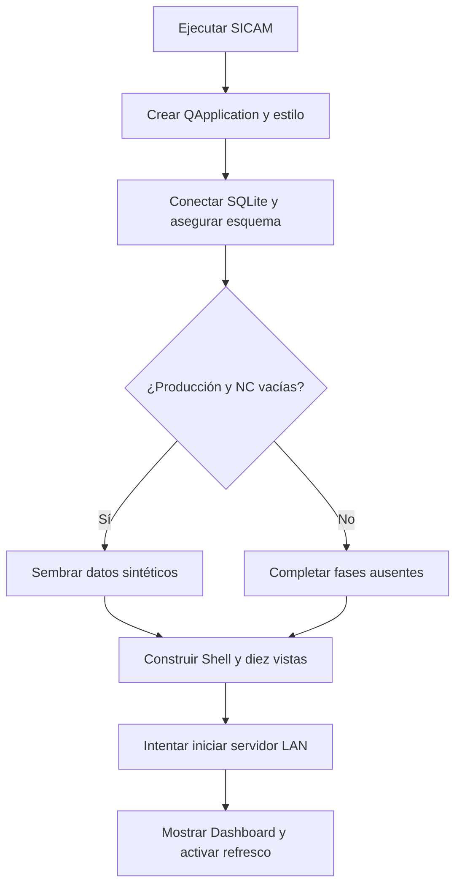
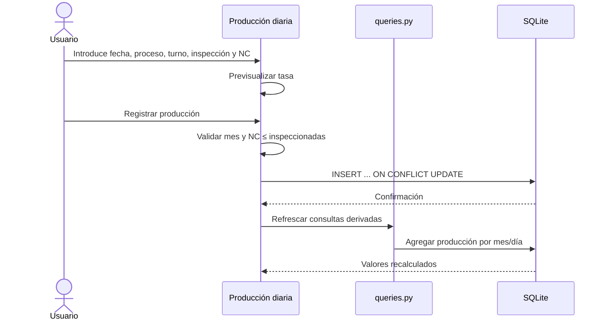
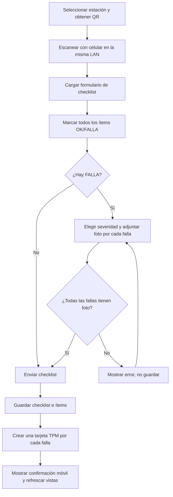
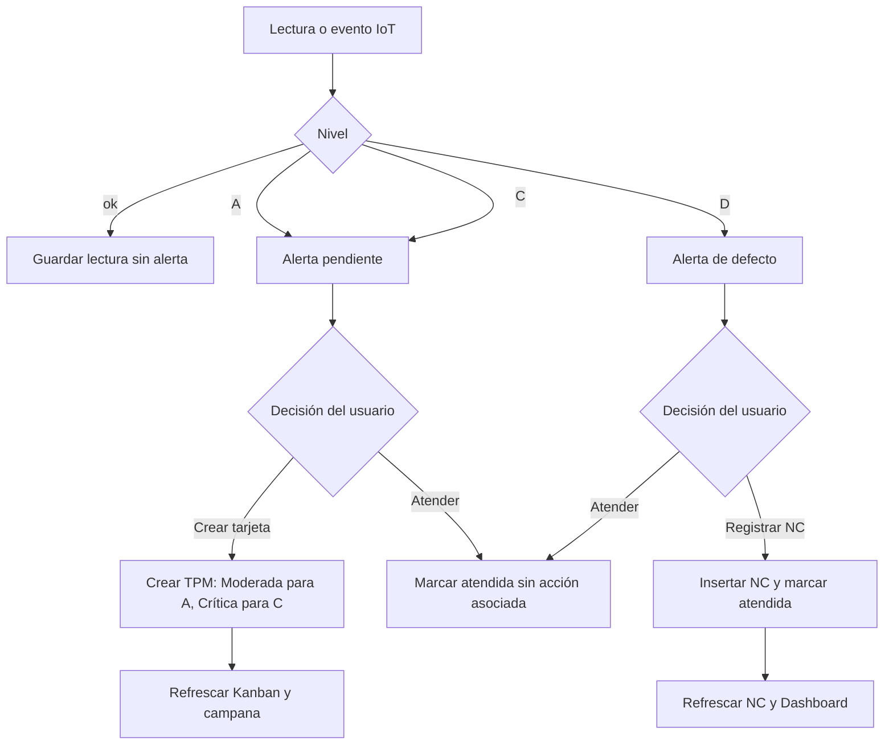

# SICAM — Procesos de negocio y flujos operativos

> **Fuente revisada:** rama `main`, commit [`c6ba4a275a90bc7791a3cd10daef4c2fd4392c3f`](https://github.com/4beru/sicam-tf-in45/commit/c6ba4a275a90bc7791a3cd10daef4c2fd4392c3f), 11-10-2026.  
> El documento separa los flujos soportados por lógica de negocio de aquellos cuya ruta de interfaz presenta un defecto conocido. La presencia de un flujo en este manual no significa que se haya ejecutado físicamente una operación industrial.

## 1. Criterio para contar flujos

Se identifican **15 flujos funcionales**. Se considera flujo independiente una secuencia con un objetivo reconocible, un evento de inicio y un resultado persistido o producido. Variaciones que comparten el mismo motor y resultado se documentan dentro de un flujo; por ejemplo, las lecturas IoT simuladas y las del ESP32 forman parte de la recepción de lecturas, aunque se separa el tratamiento posterior de las alertas. Los botones aislados de cambio de tema o navegación son interacciones de interfaz, no procesos de negocio.

## 2. Índice de flujos

| N.º | Flujo | Inicio | Resultado principal | Verificación |
|---:|---|---|---|---|
| 1 | Arranque, inicialización y servicios | Ejecutar SICAM | Esquema listo, seed según condición y Shell visible | `app/main.py`, estado y ruta de BD |
| 2 | Registro de producción y análisis de tasa | Producción diaria | Alta o actualización de la clave fecha/proceso/turno | Tabla mensual, Dashboard |
| 3 | Registro y consulta de no conformidades | No conformidades | Nueva fila descriptiva de prendas afectadas | Filtros, resumen, Pareto |
| 4 | Checklist móvil con evidencia | QR/URL de estación | Checklist, ítems, fotos y tarjetas por fallas | Mensaje móvil y Kanban TPM |
| 5 | Ciclo de vida de tarjeta TPM | Kanban o alta manual | Tarjeta abierta, en atención o cerrada | Columna, responsable, fecha de cierre |
| 6 | Consulta y priorización de máquina | Máquinas | Ficha, criticidad, calibración, historial y plan próximo | Datos de la máquina y tarjetas |
| 7 | Planificación y registro de mantenimiento | Plan TPM | Ejecución almacenada y fechas próximas recalculadas | `plan_ejecuciones`, resumen y grid |
| 8 | Captura de lecturas IoT | Simulador o `POST /iot/lectura` | Lecturas persistidas y eventualmente alerta A/C | Gauges, historial y tabla de alertas |
| 9 | Clasificación y atención de alerta IoT | Registro de alertas | Tarjeta TPM, NC (nivel D) o cierre de alerta | Estado atendida y efecto persistido |
| 10 | Generar plantilla Excel | Datos e importación | XLSX con hojas y catálogos desplegables | Abrir archivo y revisar hojas |
| 11 | Validar e importar XLSX | Seleccionar archivo | Rechazo sin importar o upsert/insert + historial | Dialogo de errores o conteos importados |
| 12 | Generar reportes/exportar NC | Reportes o Datos | PDF o XLSX escrito en ubicación seleccionada | Abrir archivo; datos fuente intactos |
| 13 | Auditar y sanear integridad | Datos e importación | Reparaciones inequívocas e informe de problemas | Resultado `integridad_sqlite`, reparaciones y problemas |
| 14 | Restablecer piloto sintético | Confirmación destructiva | Seed regenerada o recuperación desde copia en memoria | Auditoría limpia, meses y conteos |
| 15 | Detectar cambios y refrescar vistas | Timer del Shell | Campana y página activa actualizadas | Datos visibles tras un máximo aproximado de 5 s |

## 3. Flujos detallados

### Flujo 1 — Arranque, inicialización y servicios

**Objetivo:** abrir la aplicación con esquema disponible, catálogos y servicios inicializados sin sembrar de nuevo una base ya poblada.

**Inicio y precondiciones:** ejecutar `uv run python -m app.main` o el lanzador raíz. Se requiere Python compatible con el proyecto y dependencias instaladas. La carpeta de datos debe poder crearse y escribirse.

1. `app/main.py::main()` crea `QApplication`, define nombre de la aplicación y estilo.
2. Actualiza los colores cacheados de gráficos.
3. `db.conectar()` resuelve la ruta, crea la carpeta, abre SQLite, activa WAL y claves foráneas y ejecuta el esquema idempotente.
4. Cuenta `no_conformidades` y `produccion`.
5. Si ambas tablas están vacías, ejecuta `seed.siembra(conn)`; si no, asegura máquinas de costura y si faltan registros de fases concretas agrega plantillas/checklists, ejecuciones o datos IoT.
6. Construye `Shell`, diez páginas y sus áreas de scroll.
7. Intenta iniciar `ServidorLAN` en el puerto 8080. Un error de socket se refleja en la barra de estado, no debería borrar los datos.
8. La ventana navega al Dashboard, calcula la firma de datos y pone en marcha un timer de 5 segundos.

**Datos/tablas:** puede crear o completar todas las tablas de SICAM, principalmente `maquinas`, `operarios`, `produccion`, `no_conformidades`, `checklists`, `tarjetas_tpm`, `plan_ejecuciones`, `iot_umbrales`, `iot_lecturas`, `frecuencias` y `metas`.

**Decisiones y advertencias:** el seed inicial se decide a partir de que producción y NC estén vacías, no de que toda la base esté vacía. Si una base contiene datos parciales de una fase anterior, la inicialización agrega solo lo que detecta ausente. La semilla es sintética; un aviso de “primera ejecución” lo comunica.

**Resultado esperado:** ventana lista, ruta SQLite visible en la barra de estado, y URL móvil si el servidor pudo iniciarse.



**Pruebas relacionadas:** `tests/test_seed.py`, `tests/test_web.py`, pruebas de UI en `tests/test_iot_ui.py`. No hay evidencia de que las pruebas automáticas sustituyan la comprobación de instalación en todas las máquinas de usuario.

### Flujo 2 — Registro de producción y análisis de tasa

**Objetivo:** persistir el total de prendas inspeccionadas y el total de no conformidades detectadas en un proceso y turno.

**Inicio:** vista “Producción diaria”. El usuario selecciona fecha, proceso, turno, prendas inspeccionadas y NC detectadas.

1. La previsualización recalcula `NC / inspeccionadas × 100` al cambiar los dos valores numéricos.
2. Al pulsar “Registrar producción”, SICAM valida que la fecha pertenezca al mes elegido en la barra superior.
3. Comprueba que NC no supere inspeccionadas. Los controles numéricos ya limitan inspeccionadas a 1–1.000.000 y NC a 0–1.000.000.
4. Ejecuta `INSERT ... ON CONFLICT (fecha, proceso, turno) DO UPDATE`.
5. Si ya existe esa combinación, **reemplaza** sus totales por los introducidos; no incrementa el registro anterior.
6. Marca `origen_dato='manual'`, muestra confirmación y refresca las demás vistas.
7. Dashboard calcula el resumen mensual sumando los registros de producción de ese mes; la tasa mensual se obtiene del total NC dividido por el total inspeccionado, no del promedio simple de las tasas por fila.

**Tablas:** `produccion`. Dashboard también lee `no_conformidades` por proceso/causa para otras prioridades, pero no crea una relación de clave entre una inspección y una NC específica.

**Errores:** fecha fuera del periodo; cantidad de NC mayor que inspeccionadas; error SQLite. No inventar una asociación uno-a-uno con la captura de NC.

**Pruebas relacionadas:** `tests/test_seed.py`, `tests/test_integridad.py`. No se encontró un test independiente que automatice de extremo a extremo el formulario de producción diaria.



### Flujo 3 — Registro y consulta de no conformidades

**Objetivo:** describir un defecto encontrado, su causa categorizada y la cantidad de prendas involucradas.

1. Entrar a “No conformidades”, usar una vista rápida (Todas, Este turno · Costura, Hoy, Causa: máquinas) o combinar proceso, turno, causa y fechas.
2. Pulsar “Registrar no conformidad”. El sistema asigna la fecha al día actual si el mes global es el corriente; si no, asigna el primer día del mes activo. El diálogo no tiene un control de fecha visible.
3. Seleccionar proceso, turno y causa raíz; el campo de defecto concreto es obligatorio. Operario y máquina pueden quedar en “—”. Cantidad va de 1 a 100.000. Observación es opcional.
4. Si se selecciona por accidente un encabezado separador de causa, el código sustituye la selección por la primera causa del catálogo.
5. Al guardar, se inserta una fila en `no_conformidades`; no se actualiza una fila existente por clave natural.
6. La tabla vuelve a consultar según los filtros, orden por fecha e ID descendentes y un máximo de 200 filas.
7. El resumen muestra número de registros y suma de `cantidad` sobre esas filas visibles.
8. Dashboard/Pareto agrupa `cantidad` por causa. El ranking por proceso/máquina también usa sumas de cantidad.

**Resultado:** evidencia descriptiva que permite analizar volumen/categoría. No enlaza una fila individualmente con un registro de `produccion`.

**Pruebas:** cobertura funcional indirecta en `tests/test_seed.py`, `tests/test_iot.py`, `tests/test_web.py`; no se identificó test de cada filtro rápido de la página NC.

### Flujo 4 — Checklist móvil con evidencia y tarjeta TPM automática

**Objetivo:** permitir al operario verificar una estación desde un teléfono y levantar tarjetas cuando un ítem falla.

**Precondiciones:** PC que ejecuta SICAM y celular en la misma red local; servidor LAN activo, puerto 8080 permitido y código de máquina existente. La interfaz de QR presenta máquinas “Costura 001” a “Costura 030”.

1. En “Checklists”, seleccionar estación. SICAM crea un QR/URL `http://IP-del-PC:8080/<CODIGO>`; “Imprimir QR…” en realidad abre un diálogo para guardar PNG, que luego se puede imprimir.
2. En el celular, escanear QR, elegir turno y operario y marcar cada ítem `OK` o `FALLA`.
3. Cada ítem `FALLA` muestra la elección de severidad, comentario opcional y foto marcada obligatoria en interfaz web.
4. La página móvil habilita guardar solo cuando cada ítem está verificado; requiere foto para cada falla y avisa si falta.
5. El navegador reduce la imagen a un máximo de 1280 píxeles y JPEG (si el navegador admite esa operación) antes de enviar `multipart/form-data` a `POST /<maquina>/guardar`.
6. Flask valida que la máquina exista y que cada falla incluya foto. Si falta, devuelve HTTP 400 y no crea el checklist.
7. `checklists.registrar_checklist` valida el turno y estados/severidad, persiste checklist e ítems y guarda fotografías en carpeta `fotos`.
8. Por cada ítem marcado como falla, crea una tarjeta TPM individual (`tipo='Mantenimiento'`, origen `Checklist`, con el mismo `checklist_id`, severidad de la falla y descripción con el comentario).
9. La página móvil presenta el número del checklist y las tarjetas generadas. La vista desktop refresca en el siguiente ciclo de reactividad y la campana se recalcula.
10. En desktop se abre el detalle mediante doble clic en la tabla de últimos checklists, con opciones para abrir las fotos; en Tarjetas TPM se gestiona la anomalía.

**Consecuencias:** una falla genera tarjeta por ítem, no una tarjeta única por formulario; fotos permanecen fuera de SQLite como archivos y solo su ruta se guarda en `checklist_items.foto`. El límite HTTP general del formulario es 16 MB por solicitud.

**Precaución:** la obligatoriedad de foto está en la lógica móvil web, no en la función core de registro cuando es invocada directamente por otro código.



**Pruebas:** `tests/test_checklists.py`, `tests/test_web.py`, `tests/test_datos_reset.py`.

### Flujo 5 — Ciclo de vida de tarjeta TPM

**Objetivo:** hacer visible y rastreable una anomalía de estación/equipo hasta su cierre administrativo.

**Orígenes:** checklist, alerta IoT A/C o registro manual. Los estados admitidos en SQLite/core son `abierta`, `atencion`, `cerrada`.

1. La tarjeta se origina abierta. Se muestra con código legible `TPM-####`, tipo, severidad, descripción, máquina, fuente y hora de creación.
2. En Tarjetas TPM se puede filtrar por origen y abrir detalle.
3. Para una tarjeta abierta, “Tomar (en atención)” cambia estado a `atencion` y asigna por el momento el responsable fijo `Téc. Mendoza`.
4. “Cerrar tarjeta” marca `cerrada`, el mismo responsable y `cerrada_en` con fecha/hora local. La UI no solicita al usuario un responsable ni una nota de cierre.
5. El código core puede también volver a poner una tarjeta en abierta; la UI no expone esta transición desde una tarjeta cerrada.
6. La campana disminuye cuando la tarjeta ya está cerrada; vistas y Dashboard se refrescan.

**Interpretación:** el estado indica ciclo de seguimiento dentro de SICAM. No acredita que el equipo haya sido reparado físicamente ni que se haya verificado la eficacia. La acción por severidad es texto recomendado, no un automatismo. Aunque un toast actual dice “MTTR recalculado”, no se encontró almacenamiento ni cálculo de MTTR en el modelo consultado.

**Pruebas:** `tests/test_checklists.py::test_ciclo_de_vida_de_tarjeta` y tests UI para acciones IoT. No se encontró test específico que valide el diálogo completo de tarjeta manual.

### Flujo 6 — Consulta y priorización de máquina

**Objetivo:** contextualizar una estación mediante su ficha, criticidad, estado de calibración y tarjetas.

1. Abrir “Máquinas”; la lista está ordenada por código y selecciona la primera inicialmente.
2. Elegir una máquina; la ficha lee sus datos de `maquinas`.
3. La calibración se presenta como “Sin registro” si está vacía; compara la fecha con el día actual; más de 90 días implica “Vencida”. Si el texto no se parsea como ISO, se muestra el valor sin clasificar.
4. Consulta tarjetas con estado distinto de cerrada, un total de tarjetas etiquetado como “12 m” (pero la consulta no aplica filtro de doce meses; representa todo el histórico) y una próxima tarea derivada del plan actual.
5. El gráfico agrupa tarjetas por mes de creación en el último año.
6. “Nueva tarjeta para esta máquina” abre el diálogo TPM con máquina precargada. “Ver en plan TPM” navega al plan.

**Tablas:** `maquinas`, `tarjetas_tpm`, `frecuencias`, `plan_ejecuciones`. Las asociaciones por código de máquina son lógicas, no FKs.

### Flujo 7 — Planificación y registro de mantenimiento preventivo

**Objetivo:** derivar tareas del plan a partir de frecuencias y ejecuciones anteriores.

1. Se consultan las filas de `frecuencias` (máquina, actividad, periodicidad en días y responsable).
2. Si existe última ejecución hasta la fecha de referencia, la próxima tarea se calcula como `última ejecución + frecuencia`. Si no existe, se determina una fecha inicial determinista desde el primer día del mes y el código/actividad.
3. Se generan ocurrencias hasta el fin del mes de referencia. Semana S1: días 1–7; S2: 8–14; S3: 15–21; S4: 22 en adelante.
4. Estado `over` si ya pasó la fecha; `soon` si faltan 7 días o menos (incluye hoy); `sched` para fechas más alejadas.
5. La UI presenta vencidas, próximas, ejecutadas y cumplimiento. Una ejecución se determina por existir un registro de esa máquina/actividad en la misma semana.
6. Al pulsar una tarea no ejecutada se abre un diálogo con fecha, responsable y observación; el core insertaría `plan_ejecuciones` y las siguientes fechas se derivarían de ese registro.
7. **Defecto de la vista actual:** `EjecucionDialog._guardar` invoca `plan_tpm.registrar_ejecucion` sin pasar la conexión SQLite requerida como primer argumento. Por tanto, la acción UI no completa el flujo y puede lanzar `TypeError`. La función core se prueba correctamente cuando se llama con la conexión explícita, pero eso no valida este camino de botón.

**Consecuencia operativa:** hasta corregir y probar ese enlace UI, registrar una ejecución desde el botón del plan no debe considerarse funcionalmente validado. La generación y cálculo del motor sí tienen tests de core.

**Pruebas:** `tests/test_plan_tpm.py` cubre motor, recálculo y PDFs, no la ruta clic-del-botón.

### Flujo 8 — Captura de lecturas IoT

**Objetivo:** registrar medidas de cuatro variables o eventos simulados desde dispositivos.

**Variables y unidades:** tensión de hilo (`cN`), velocidad (`spm`), temperatura (`°C`), vibración (`mm/s`). Ver fórmulas y umbrales en `03-diccionario-funcional-datos.md`.

**Vía simulador:** cada dos segundos, si el toggle está activo, el widget genera una lectura por variable para la máquina elegida, usando un paseo aleatorio limitado por la escala. El origen se guarda como `sim`.

**Vía ESP32:** enviar JSON a `POST /iot/lectura`, por ejemplo:

```bash
curl -X POST http://IP-DEL-PC:8080/iot/lectura \
  -H 'Content-Type: application/json' \
  -d '{"maquina":"Costura 001","variable":"vibracion","valor":5.9}'
```

1. Flask exige cuerpo JSON con un objeto, máquina registrada y `variable` perteneciente a las cuatro variables si no es un evento D.
2. `valor` debe ser número y no booleano.
3. `iot.registrar_lectura` persiste `maquina`, variable, valor, nivel, origen (`esp32`) y timestamp.
4. La clasificación usa los umbrales persistidos. Si aparece una transición hacia A o C (o la primera lectura ya nace en A/C), se crea alerta; lecturas consecutivas del mismo nivel no duplican alertas mientras no cambie el nivel.
5. La vista IoT actualiza gauges y gráfico localmente cada dos segundos.

`GET /iot/estado` devuelve las últimas lecturas registradas por máquina/variable. No hay autenticación, token, HTTPS ni validación de identidad del emisor en este servidor MVP: se debe limitar a una LAN confiable.

### Flujo 9 — Clasificar y atender alerta IoT

**Tipos:** alertas A/C provienen de valores fuera del rango normal / fuera de banda de alarma; la alerta D es un evento discreto de defecto (por ejemplo etiqueta invertida). D no se calcula por `clasificar()` de variables; se inserta como evento explícito.

1. Se consulta una fila del registro de alertas; UI ofrece botones solo si `atendida=0`.
2. Para A/C, “Crear tarjeta TPM” crea una tarjeta tipo Mantenimiento. Nivel A se traduce a severidad Moderada; nivel C a Crítica; la alerta se marca atendida y se le asigna `tarjeta_id`.
3. Para nivel D, “Registrar NC” inserta en `no_conformidades`: fecha actual, turno Tarde, proceso del área de la máquina, causa fija `Descalibración de máquinas`, defecto estándar si no se proporciona, operario dash y cantidad 1 por defecto; marca la alerta atendida. La interfaz actual no pide ampliar defecto/cantidad y llama los valores predeterminados.
4. “Atender” marca `atendida=1` sin crear tarjeta ni NC.
5. La campana cuenta alertas no atendidas y tarjetas no cerradas.

**Reglas importantes:** no se puede crear tarjeta desde D ni registrar NC mediante el helper desde A/C; la función core rechaza esos usos con `ValueError`. Cambiar umbrales afecta la clasificación de nuevas lecturas, no vuelve a procesar históricas ni actualiza retroactivamente las alertas ya generadas.

**Pruebas:** `tests/test_iot.py`, `tests/test_iot_ui.py`, `tests/test_web.py`.



### Flujo 10 — Generación de plantilla Excel

1. Entrar en “Datos e importación” y pulsar “Descargar plantilla”.
2. Elegir ruta/nombre (por defecto `plantilla_sicam.xlsx`).
3. `plantilla.generar_plantilla` crea un archivo XLSX con `Leeme` y seis hojas de datos (`maquinas`, `operarios`, `produccion`, `no_conformidades`, `frecuencias`, `metas`).
4. Agrega encabezados y algunas validaciones de listas desplegables hasta la fila 2001. Esto reduce errores de escritura, pero la validación definitiva ocurre en Python.
5. El archivo no altera la base de datos.

Las columnas exactas están en el documento de datos. No incluye hojas de checklists, tarjetas TPM o IoT; la plantilla no es una exportación de todo el modelo SICAM.

### Flujo 11 — Validación e importación XLSX

1. “Seleccionar archivo…” abre un selector de `.xlsx`.
2. `importador.leer` lee solo hojas reconocidas y omite las filas vacías. Se pueden importar subconjuntos de hojas.
3. `importador.validar(datos, conn)` comprueba campos y catálogos en memoria; por sí misma no modifica los datos de negocio.
4. Si hay errores, el sistema guarda una fila en `importaciones` con estado `con errores`, presenta hoja, fila y detalle (máximo 200 errores en el cuadro) y no llama a `importar`.
5. Si está limpia, muestra conteo por hoja y pide confirmación.
6. `importador.importar` trabaja transaccionalmente. Máquinas por código, operarios por código, producción por fecha+proceso+turno, frecuencias por máquina+actividad y metas por indicador usan `ON CONFLICT ... DO UPDATE`. **No conformidades se insertan siempre y carecen de clave natural en el modelo; reimportar duplica esas filas.**
7. Se registra historial con filas contadas y estado `importado`, se muestra confirmación y se refrescan vistas.

**Limitación de campos:** exportar/importar NC no transporta `observacion` mediante la plantilla actual, pues no figura entre columnas de `HOJAS['no_conformidades']`. Algunas fechas de máquina se validan, pero la normalización validada no se copia de vuelta al texto usado en el upsert.

**Pruebas:** `tests/test_importador.py` demuestra que validar con errores deja las tablas de negocio vacías en una base de prueba y que volver a importar la misma plantilla no duplica máquinas/producción; también demuestra que las NC sí se vuelven a insertar.

### Flujo 12 — Generación de reportes y exportación

1. Elegir uno de los cuatro generadores de “Reportes”: Plan TPM PDF, Pareto PDF, Resumen de indicadores PDF o Registro de NC XLSX.
2. Seleccionar ruta y nombre.
3. Los PDF los genera `app/core/reportes.py` con ReportLab; el XLSX de NC lo genera `app/core/plantilla.py` con openpyxl.
4. Plan y Pareto usan el mes global. Resumen de indicadores toma tasa de NC del mes seleccionado, pero checklists se calcula para hoy y el resumen TPM usa el periodo operativo de la fecha de referencia del sistema (mezcla de ámbitos). Excel de Reportes filtra NC al mes activo; la opción de exportar desde Datos no pasa fechas, por lo que incluye todo el historial.
5. El archivo se guarda en el destino seleccionado. La generación de un PDF/XLSX no modifica tablas de negocio.

**Contenido principal:** el PDF de plan incluye actividad, frecuencia, S1–S4, responsable, vencidas/próximas/ejecutadas/cumplimiento; Pareto incluye barras porcentuales, acumulado y corte 80%; indicadores lista metas As-Is/To-Be y valores actuales para tasa, checklists hoy y TPM; NC Excel tiene ocho columnas compatibles con la hoja de plantilla.

**Pruebas:** `tests/test_plan_tpm.py::test_pdfs_se_generan` verifica que existen PDF con firma `%PDF-` y tamaño mínimo. No confirma revisión humana del contenido en todas las páginas.

### Flujo 13 — Auditoría y saneamiento de datos

1. Pulsar “Auditar y sanear datos” en Datos.
2. `integridad.auditar_y_reparar` elimina únicamente los huérfanos explícitos que puede atribuir sin inferir: `checklist_items` sin checklist padre y tarjetas de origen Checklist cuyo checklist padre falta.
3. Ejecuta `PRAGMA integrity_check` y `PRAGMA foreign_key_check`.
4. Comprueba fechas/cantidades de producción, fechas/catálogos/cantidades de NC, referencias de máquina en NC/checklists/tarjetas/frecuencias, desviaciones del catálogo sintético, presencia de producción/NC en Ago–Nov 2026 y conciliación de filas sintéticas de producción y NC por fecha/proceso.
5. Muestra reparaciones seguras y problemas pendientes por separado.
6. Si hay otros problemas, avisa; no intenta inventar fechas, reasignar máquinas ni cambiar cantidades.

**Límite:** `PRAGMA integrity_check=ok` confirma la integridad física de SQLite en el alcance de esa comprobación; no demuestra que las relaciones semánticas entre todos los procesos industriales sean correctas.

**Pruebas:** `tests/test_integridad.py` cubre seed limpia, eliminación de ítems huérfanos, meses de referencia, calendario y detección de desajuste semilla.

### Flujo 14 — Restablecimiento destructivo del piloto

> **No usar como botón cotidiano de mantenimiento. Sustituye los datos operativos y elimina fotografías de evidencia administradas por SICAM.**

1. En Datos, pulsar “Restablecer datos piloto”.
2. Leer la advertencia: se perderán filas manuales/importadas y registros de operación (checklists, TPM, IoT e historial de importaciones), serán sustituidos por el histórico sintético 2024 y piloto julio–noviembre 2026; fotos gestionadas por SICAM también pueden eliminarse.
3. Si el usuario confirma, el código recoge las rutas de fotos referenciadas por los ítems de checklist y copia la base SQLite a una conexión en memoria mediante `Connection.backup`.
4. Ejecuta `seed.siembra(conn, reset=True)`, que vacía tablas de SICAM y reinicia `sqlite_sequence`; vuelve a sembrar equipos, operadores, frecuencias, metas, producción, NC, checklists, tarjetas, ejecuciones, umbrales y lecturas de muestra.
5. Ejecuta la auditoría. Si integridad física falla o hay problemas semánticos, levanta error e intenta restaurar el backup desde memoria. Muestra diálogo crítico.
6. Solo si la BD regenerada pasa la comprobación, intenta eliminar cada foto previa cuya ruta resuelva dentro de `<SICAM_DATA>/fotos`; ignora los errores de borrado de archivos.
7. Actualiza la firma del Shell, refresca páginas y muestra “Datos piloto restaurados y auditados”.

**Qué puede recuperarse:** el backup recupera la base SQLite en el alcance de la copia. No incluye fotos binariamente, y las fotografías se borran después de la auditoría exitosa, por lo que no hay recuperación incorporada de las fotos ya eliminadas.

**Controles posteriores:** auditoría sin problemas; producción y NC presentes en agosto, septiembre, octubre y noviembre; catálogo de máquinas coherente; conteos y carpeta de fotos revisados según necesidad.

**Pruebas:** `tests/test_datos_reset.py` usa base y fotos aisladas en `tmp_path`, simula confirmación y verifica la limpieza de fotos y la restauración de meses. Esto no autoriza a probar el botón sobre datos reales sin backup externo.

### Flujo 15 — Detección de cambios y refresco de pantallas

1. `Shell` toma la firma al iniciar mediante `queries.firma_datos`.
2. Cada 5 segundos consulta contadores y máximos de IDs para NC, producción, checklists, tarjetas, ejecuciones y alertas, además del conteo de tarjetas abiertas/alertas IoT pendientes.
3. Si la firma no cambió, no hace nada. Si cambió, actualiza la campana y, salvo que haya un diálogo modal, llama a `refresh()` solo para la página activa.
4. Las lecturas IoT no forman parte de la firma a propósito; `IotPage` se repinta con su propio temporizador de 2 segundos.
5. Las acciones directas de escritorio también pueden ejecutar `refresh_all()` sin esperar al timer.

**Limitaciones:** una modificación directa de un campo en una fila existente que no altere contadores ni máximo ID puede pasar inadvertida para este mecanismo de firma; las operaciones normales de SICAM suelen añadir filas o modificar estados que sí se representan en la firma o refrescan directamente.

## 4. Flujo ideal recomendado de una jornada

Este recorrido conecta calidad, checklist, mantenimiento y análisis. No todas las jornadas requieren todos los pasos.

### Fase A — Preparación

1. Iniciar SICAM y revisar en la barra de estado ruta de BD y servidor para celulares.
2. Confirmar que el mes del piloto elegido coincide con el periodo que se desea revisar. Recordar que la navegación ofrece agosto–noviembre 2026, aunque la semilla incluye julio.
3. Para operación móvil, revisar que PC y celulares estén en la misma LAN y que el servidor esté activo. No utilizar el selector de usuario como barrera de seguridad.
4. Para un entorno de datos reales, confirmar que no se trabaja en modo demostración y que hay copia de seguridad antes de acciones de mantenimiento de datos.

### Fase B — Producción y calidad

1. Al cierre de cada proceso/turno, registrar prendas inspeccionadas y NC detectadas en Producción diaria.
2. Registrar los defectos mediante No conformidades y completar causa, defecto, cantidad y máquina/operario si se conocen.
3. Confirmar en las tablas que los valores son plausibles; evitar asumir una relación automática entre las dos capturas.
4. Revisar la tasa, diferencia vs. mes anterior y Pareto; priorizar causas con alto volumen acumulado.

### Fase C — Controles operativos

1. Abrir Checklists; revisar estación, URL y servidor LAN.
2. El operario escanea su QR y completa todos los ítems desde el celular.
3. Ante una falla, seleccionar severidad, describir la observación y adjuntar evidencia fotográfica.
4. Confirmar el mensaje de guardado y comprobar que la cantidad de checklists/fallas aparece en el escritorio.

### Fase D — Tratamiento de anomalías

1. El supervisor abre Tarjetas TPM y filtra Checklist/IoT/Manual según proceda.
2. Examina detalle, severidad y evidencia disponible.
3. Toma la tarjeta en atención y asigna internamente a quien corresponda; la UI actual deja como responsable fijo `Téc. Mendoza`, por lo que una organización real deberá acordar la interpretación de ese dato o corregir el diseño.
4. Solo cerrar después de verificar la intervención fuera del software y disponer de evidencia suficiente en el procedimiento operativo de la organización. SICAM actualmente no fuerza ese requisito.

### Fase E — Mantenimiento preventivo

1. Consultar ficha de Máquinas: criticidad, calibración, tarjetas y tarea próxima.
2. Revisar Plan TPM y seleccionar tareas vencidas/próximas.
3. **La ruta de registro desde la interfaz presenta un defecto de argumentos confirmado en código.** No dar por registrada una ejecución si no aparece en la tabla y en la base; el test del motor core no cubre este botón.
4. Una vez que el defecto esté corregido y probado, registrar fecha, responsable y observación, verificar que la tarea cambió de estado y que la próxima fecha se recalculó.

### Fase F — Monitorización

1. Revisar los gauges y distinguir origen `sim` de `esp32` en historial/BD.
2. Evaluar alertas A/C. Crear tarjeta para las que requieren atención de mantenimiento o marcar atendida solo si el procedimiento definido permite ese cierre.
3. Ante alerta D, inspeccionar el proceso y confirmar si se debe formalizar NC; la operación integrada usa causa `Descalibración de máquinas` y turno `Tarde` por defecto, por lo que requiere revisión del dato si el escenario real difiere.
4. Evitar interpretar una alerta marcada como atendida como prueba de reparación física.

### Fase G — Cierre y análisis

1. Volver al Dashboard y comparar tasa, volumen, Pareto, rankings, cumplimiento de checklists y del plan.
2. Generar PDF/Excel del periodo correcto. Revisar el alcance temporal de cada informe, pues los indicadores combinan datos del mes y datos operativos del día/mes actual.
3. Ejecutar auditoría solo cuando haya una razón (importación, restauración o revisión de calidad de datos), interpretar su salida y documentar correcciones manuales.
4. No restablecer datos piloto sobre una base de operación real.

## 5. Ejemplo end-to-end realista soportado

**Escenario:** durante la verificación de la estación `Costura 001`, el operario detecta una tensión del hilo anómala.

1. Escanea el QR y abre el checklist de esa máquina.
2. Marca “Tensión del hilo (prueba en retazo)” como `FALLA`, selecciona `Moderada`, comenta “costura fruncida al iniciar” y carga fotografía.
3. Guarda el checklist; el servidor valida evidencia y SICAM registra `checklists`, el ítem de `checklist_items` y una tarjeta en `tarjetas_tpm` con origen Checklist, severidad Moderada y la observación.
4. En el escritorio se consulta el último checklist y se abre su detalle. Después se abre Tarjetas TPM y la tarjeta asociada.
5. Personal de mantenimiento revisa la foto y recomendación “Revisión por mantenimiento”. El usuario pulsa “Tomar (en atención)”; SICAM pone el estado en atención y asigna el responsable codificado por la UI.
6. La organización hace el trabajo técnico real fuera de SICAM y comprueba la calidad de la puntada.
7. Si el resultado es aceptable, el usuario pulsa “Cerrar tarjeta”; se guarda estado cerrada y fecha/hora de cierre.
8. Supervisor revisa que no quede en “Abiertas/En atención” y consulta Dashboard/pareto para evaluar la tendencia del proceso.

**Límite del ejemplo:** el sistema no registra una orden de trabajo técnica detallada, repuestos, tiempo real invertido ni validación formal de eficacia. El cierre registra el cambio administrativo de estado, no certifica por sí solo el resultado industrial.

## 6. Recorridos recomendados por perfil funcional

Estos recorridos son una organización del trabajo, no permisos técnicos. El selector de usuario no restringe accesos.

### Supervisor de producción/calidad

- Antes de jornada/cierre: Dashboard → Producción diaria → No conformidades.
- Consulta tasa y variación, causa dominante, proceso y rankings; registra o valida la captura de NC.
- Después de checklist/alertas: revisa Tarjetas TPM, confirma severidad y estado de seguimiento.
- Al cierre del periodo: genera Pareto/indicadores PDF y contrasta el periodo del selector con los datos exportados.

### Operario de estación

- Acceso principal por QR móvil; selecciona turno y nombre, revisa ítems, registra OK/FALLA, adjunta foto ante falla y guarda.
- Verifica la pantalla de confirmación y el número de checklist. No necesita usar la aplicación de escritorio para que la tarjeta se cree.
- El sistema no autentica al operario: el nombre se selecciona en un desplegable y no prueba identidad.

### Personal de mantenimiento

- Máquinas → Plan TPM → Tarjetas TPM.
- Consulta criticidad, calibración y anomalías; da seguimiento a tarjetas con los límites expuestos.
- Hasta corregir y probar el defecto del botón del plan, verifica la persistencia antes de asumir una ejecución registrada.
- La interfaz no permite configurar permisos, programar recursos/turnos de técnicos o adjuntar informe de intervención estructurado.

### Responsable de datos/sistema

- Verifica ruta de base, salud del servidor y conectividad local.
- Usa Plantilla de carga, Dry-run, revisa errores, corrige XLSX e importa; controla especialmente las duplicaciones de NC.
- Exporta informes, consulta historial de importación, ejecuta auditoría ante incidencias.
- Restablece piloto solamente en una base que deba volver a la demostración, con copia externa cuando los datos importen.

## 7. Matriz breve de precondiciones y resultado

| Operación | ¿Obligatoria en cada jornada? | Dependencia | Verificación imprescindible |
|---|---|---|---|
| Arranque y estado de BD | Sí | Acceso de escritura a ruta de datos | Dashboard y barra de estado |
| Registro de producción | Condicional: si se usa control cuantitativo | Totales de inspección fiables | Tabla y tasa recalculada |
| Registro de NC | Condicional: ante defectos/NC | Categorización informada | Filtros y Pareto |
| Checklist móvil | Según plan de control de estación | LAN/servidor disponible | Confirmación, fotografía y tarjeta cuando hay falla |
| Gestionar tarjeta TPM | Condicional: si hay anomalía | Tarjeta abierta | Estado y responsable coherentes |
| Ejecutar mantenimiento TPM | Según frecuencia del equipo | Plan y flujo UI operativo | Fila nueva en historial y estado recalculado |
| Revisar IoT | Opcional/según equipos integrados | Simulador o ESP32 | Distinguir origen real/simulado |
| Reportes | Al cierre o solicitud | Datos con periodo correcto | Abrir archivo generado |
| Auditar integridad | Condicional | Acceso a DB | Informe de reparaciones/problemas |
| Restablecer piloto | Solo para volver a demo | Confirmación y datos prescindibles | Auditoría sin problemas; fotos revisadas |

## 8. Recuperación y precauciones transversales

- **No borrar datos para resolver dudas:** primero exportar o copiar la base, ejecutar auditoría y conservar mensajes de error.
- **No confundir registro con diagnóstico:** una alerta IoT se basa en umbrales configurados; no equivale a una inspección metrológica ni a un diagnóstico del fabricante.
- **No confiar solo en el color:** las fórmulas y periodos se describen en `03-diccionario-funcional-datos.md`.
- **Validar el periodo:** el mes global filtra ciertas vistas, no modifica el “hoy” real de checklists, alertas ni todos los KPIs.
- **Verificar persistencia tras acciones con defectos conocidos:** en particular la ejecución desde la UI de Plan TPM.
- **Red local:** el servidor móvil no contiene autenticación; el puerto debe limitarse al contexto de confianza previsto.