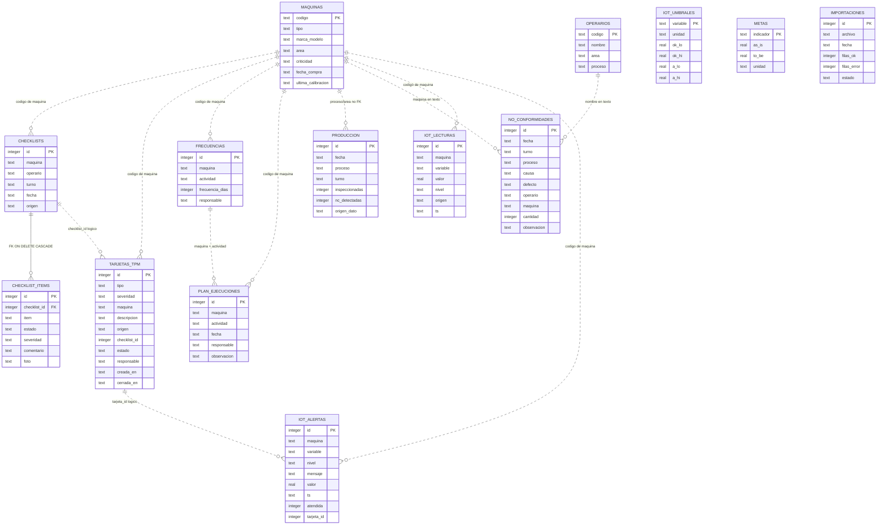
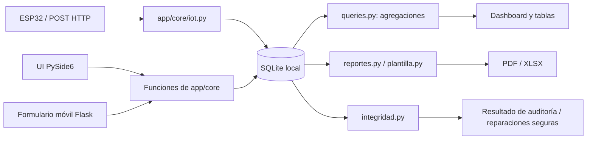

# SICAM — Diccionario funcional, métricas y modelo de datos

> **Fuente revisada:** `main` en [`c6ba4a275a90bc7791a3cd10daef4c2fd4392c3f`](https://github.com/4beru/sicam-tf-in45/commit/c6ba4a275a90bc7791a3cd10daef4c2fd4392c3f). Las fórmulas que siguen se extraen de las funciones vigentes, no del significado informal de los nombres.

## 1. Convenciones para interpretar los datos

SICAM reúne una base de calidad (registros diarios de producción y no conformidades), controles de estación (checklists), seguimiento de anomalías (tarjetas TPM), calendario de mantenimiento y lecturas/alertas IoT. SQLite almacena esos conjuntos, pero no existe una relación relacional formal que una cada registro de producción con una NC individual, ni todas las tablas tienen claves foráneas hacia máquinas.

La columna `cantidad` de `no_conformidades` representa prendas afectadas en el registro. Por ello, algunos rankings y porcentajes cuentan **prendas agrupadas por categoría**, no el número de filas de NC. Cuando el manual indica “registros” está hablando de filas; cuando indica “prendas NC”, está sumando `cantidad`.

## 2. Diccionario de indicadores

### 2.1 Calidad de producción

| Etiqueta / nombre interno | Fórmula exacta en el código | Fuente y periodo | Interpretación y limitación |
|---|---|---|---|
| Tasa de no conformidad (resumen del mes) | `SUM(produccion.nc_detectadas) / SUM(produccion.inspeccionadas) * 100`, redondeo a 2 decimales. Si inspección total es 0, se muestra `0.0`. | `queries.resumen_mes(conn, mes)`, tabla `produccion`, límites inclusivos del mes. | Menor suele ser mejor. No es el promedio simple de tasas por fila. La tasa usa los totales de `produccion`, no suma de cantidad de `no_conformidades`. |
| Tasa NC por registro en tabla Producción | `nc_detectadas / inspeccionadas * 100`, mostrado a 1 decimal. | Cada fila individual de `produccion`. | Colorea rojo si es `>7%`, ámbar si `>5%`, verde en el resto. Estos cortes son de presentación y no son el valor To-Be (4,95%). |
| Tasa NC diaria | `SUM(nc_detectadas del día) / SUM(inspeccionadas del día) * 100`, redondeo 2 decimales. | `queries.tasa_diaria`, agregación por `fecha`. Con mes indicado consulta los últimos N días que tienen filas en ese mes. | “Últimos 14 días” puede significar las últimas 14 fechas con registros, no una ventana de 14 días calendario. |
| NC registradas en Dashboard | `SUM(nc_detectadas)` de los registros de `produccion` del mes activo. | `queries.resumen_mes`; tabla `produccion`. | La etiqueta “NC” de esta tarjeta presenta el total de detecciones registradas en producción. No equivale a conteo de filas de `no_conformidades` ni necesariamente a suma de su columna `cantidad` si datos reales no fueron reconciliados. |
| Prendas inspeccionadas | `SUM(inspeccionadas)` del mes activo. | `produccion`. | Denominador de la tasa del mes. Debe representar el volumen efectivamente inspeccionado para que el porcentaje tenga sentido. |
| Variación vs. mes anterior | `tasa_mes_actual - tasa_mes_anterior`, con tasas a 2 decimales; muestra puntos porcentuales (pp). | `queries.resumen_mes`. | Valor negativo indica tasa menor; positivo, mayor. Si el mes previo no tiene inspección, delta no se calcula. |
| Tasa mensual de tendencia | Igual fórmula agregada por mes: `SUM(nc_detectadas)/SUM(inspeccionadas)*100`, 2 decimales. | `queries.tasa_mensual`, todos los meses con producción. | Marca como “piloto” meses `>= 2026-07`; la banda As-Is/To-Be procede de `metas`. La curva puede mezclar información sintética y registros reales/importados si conviven en la base. |
| Causa dominante | Orden descendente de `SUM(no_conformidades.cantidad)` agrupado por causa dentro del periodo. Su porcentaje es `cantidad de causa / cantidad total de NC del periodo * 100`, 1 decimal. | `queries.pareto`, usa el periodo solicitado; Dashboard y reportes filtran al mes activo. | Es la causa con más prendas afectadas, no necesariamente la causa con más filas. |
| Pareto — porcentaje por causa | `SUM(cantidad) causa / SUM(cantidad total) * 100`, redondeo de cada porcentaje a 1 decimal. | `queries.pareto(conn, desde, hasta)`. | La suma de porcentajes redondeados puede no ser exactamente 100%. |
| Pareto — acumulado | En PDF el código suma cada porcentaje y normaliza usando la suma de porcentajes ya redondeados; el widget Dashboard dibuja acumulado de las categorías ordenadas. | `reportes.pdf_pareto`; `ParetoWidget` en `ui/charts.py`. | La línea 80% es referencia de priorización, no una garantía de que el 20% de causas produzca exactamente 80% de todos los defectos. |
| NC por proceso | `SUM(no_conformidades.cantidad)` agrupado por `proceso`, dentro del mes, ordenado desc. | `queries.resumen_mes`. | El proceso con más NC se calcula a partir de registros descriptivos de NC, mientras que el KPI de tasa procede de producción. Las fuentes no se enlazan fila a fila. |
| Ranking de operarios · Corte | `SUM(cantidad)` de `no_conformidades` con `proceso='Corte'`, `operario!='—'`, rango de fecha dado, agrupado por nombre y orden desc; máximo 5. | `queries.ranking_operarios`; Dashboard pasa el mes seleccionado. | No es tasa individual ajustada por número de prendas procesadas ni un indicador automático de culpa. Se puede sesgar por volumen, registro y atribución del operario. |
| Ranking de máquinas con más NC | `SUM(cantidad)` en NC donde `maquina!='—'`, agrupado por código, fecha y orden desc; máximo 5. | `queries.ranking_maquinas`; Dashboard pasa el mes seleccionado. | Indica volumen registrado asociado a una máquina, no tasa de fallo por hora ni criticidad por sí sola. |
| As-Is de tasa NC | Valor de `metas.as_is` para “Tasa de prendas no conformes”; fallback 10,68 si no existe. | Tabla `metas`, seed por defecto: 10,68%. | Referencia de línea base del piloto, no se vuelve a calcular del histórico de manera dinámica cada vez que se muestra. |
| To-Be de tasa NC | Valor `metas.to_be` para ese indicador; fallback 4,95%. | `metas`. | Objetivo estático configurable por datos/importación. “En meta” se evalúa como tasa actual `<= To-Be`. |

### 2.2 Operación, mantenimiento e IoT

| Indicador visible | Fórmula / lógica | Periodo / fuente | Limitaciones |
|---|---|---|---|
| Cumplimiento de checklists | `COUNT(DISTINCT checklists.maquina WHERE fecha=hoy) / COUNT(maquinas) * 100`, redondeo a 0 decimales. | `checklists.cumplimiento_hoy`; usa día real actual, no mes global. | Cuenta estaciones con al menos un checklist hoy; no calcula porcentaje de ítems OK ni impide varios checklists en una máquina. |
| Estaciones completadas hoy | Conteo distinto de `maquina` con checklist para hoy. | `checklists`, fecha actual del sistema. | Una estación se cuenta una sola vez, aunque registre más de uno. |
| Total estaciones | `COUNT(*) FROM maquinas`. | Catálogo actual de máquinas. | La semilla actual tiene 30 máquinas, así que 5 checklists sintéticos representarían 5/30 = 16,7%, no 5/7. |
| Ítems con falla declarada hoy | `COUNT(*)` de `checklist_items` con estado falla unido a `checklists` con fecha hoy. | Checklist del día. | Cuenta ítems fallidos, no cantidad de máquinas ni tarjetas. |
| Tarjetas TPM generadas hoy | `COUNT(*) FROM tarjetas_tpm WHERE date(creada_en)=hoy`. | Todas las tarjetas por fecha de creación. | No filtra origen; puede incluir Manual, Checklist, IoT y datos sintéticos. |
| Cumplimiento plan TPM | `len(ejecuciones del mes) / (len(ejecuciones del mes) + tareas vencidas) * 100`; si denominador es 0, 100%. | `plan_tpm.resumen`; usa las ejecuciones y tareas del mes de referencia del motor. | Las tareas próximas y programadas no integran el denominador; las ejecuciones pueden incluir más de un registro de la misma tarea y entonces influyen directamente en el numerador. No debe interpretarse como porcentaje de cada tarea comprometida completada sin esa salvedad. |
| Tareas vencidas | Número de ocurrencias generadas del mes con `estado='over'`, definido por `(fecha tarea - fecha de referencia).days < 0`. | `plan_tpm.tareas_del_mes`. | “Hoy” no es vencida; `soon` incluye hoy y hasta siete días de anticipación. |
| Tareas próximas | Conteo con estado `soon` (`días <= 7` y no negativo). | Motor TPM. | Se excluyen las ya vencidas. |
| Tareas programadas | Conteo con estado `sched`, cuando quedan más de 7 días. | Motor TPM. | Sólo ocurrencias generadas dentro del fin del mes de referencia. |
| Ejecuciones del mes | `COUNT(*)` de `plan_ejecuciones` cuya fecha coincide con prefijo `AAAA-MM`. | Tabla `plan_ejecuciones`, mes de referencia. | Cuenta filas de ejecución, no necesariamente actividades únicas. |
| Próxima tarea de máquina | Escoge la tarea de `tareas_del_mes` para ese código de máquina con la fecha mínima. | `plan_tpm.proxima_tarea(conn, maquina)`. | Esta ficha usa mes y fecha del día actual, no el mes global del navbar. |
| Tarjetas abiertas | `COUNT(*)` para máquina y `estado!='cerrada'`. | `tarjetas_tpm`. | Incluye abiertas y en atención. |
| “Tarjetas 12 m” de la ficha de máquina | **En el código actual es `COUNT(*) FROM tarjetas_tpm WHERE maquina=?`, sin filtro temporal.** | `tarjetas_tpm`. | Etiqueta y cálculo no coinciden: el valor es histórico de todos los tiempos. El gráfico mensual sí tiene filtro desde aproximadamente un año atrás. |
| Estado calibración | Si no hay fecha: “Sin registro”; si ISO parseable, calcula `(hoy - fecha_calibracion).days`; `>90` vencida, en otro caso al día. | `maquinas.ultima_calibracion`; fecha real actual. | La fecha futura también se etiqueta al día con días negativos. Texto de fecha no ISO se muestra sin clasificación; importación puede almacenar una fecha válida originalmente escrita en formato no ISO sin normalizarla. |
| Alertas IoT pendientes | `COUNT(*) FROM iot_alertas WHERE atendida=0`. | Todas las alertas IoT, sin restricción por mes ni máquina. | No es la cantidad de señales en rango alto: es la cantidad de filas de alerta pendientes. |
| Nivel de lectura | Si `ok_lo <= valor <= ok_hi`: `ok`; else si `a_lo <= valor <= a_hi`: `A`; else `C`. | `iot.clasificar(valor, umbral)`. | La lógica no valida que la configuración de umbrales sea coherente. Los valores predeterminados de vibración incluyen `a_lo=-1`, por lo que ese rango inferior no representa necesariamente una alarma física real. |
| Generación de alerta continua | Nueva fila `iot_alertas` para una lectura A/C si no había lectura previa o si el nivel difiere del anterior para la misma máquina/variable. | `iot.registrar_lectura`. | Dos lecturas C sucesivas no producen dos alertas; volver de A a C produce una alerta de nueva transición. |
| Alerta D | Evento discreto insertado explícitamente con `nivel='D'`. | `iot.registrar_alerta`; endpoint `/iot/lectura` con nivel D o botón de simulación. | No se obtiene del clasificador analógico ni se puede derivar la realidad de una prenda sólo por el valor del evento. |
| Historial IoT visible | Últimas 60 filas consultadas por ID descendente y revertidas a orden ascendente. | `iot.historial`; `LineaEnVivoWidget`. | La vista tiene título “Última hora”, pero la consulta limita por cantidad de puntos, no filtra por timestamp de la última hora. Con simulación cada 2 s, 60 puntos representan aproximadamente dos minutos por variable, no sesenta minutos. |
| As-Is/To-Be de otros KPIs | `metas` guarda referencia y objetivo de más indicadores. | Datos sintéticos/importación. | En PDF de indicadores, los valores actuales sólo se suministran para tasa, checklists de hoy y plan TPM; para otros indicadores se muestra `—`, no una medición dinámica. |

## 3. Umbrales IoT confirmados en código

Los valores de abajo son los predeterminados de `app/core/iot.py::UMBRALES_POR_DEFECTO`, persistidos en `iot_umbrales`. Pueden modificarse desde “Guardar umbrales”.

| Variable | Unidad | Escala visual mínima–máxima | Rango normal inclusivo | Banda A inclusiva | Si no es normal ni A |
|---|---|---:|---:|---:|---|
| Tensión de hilo (`tension`) | cN | 35–65 | 45–55 | 40–60 | C |
| Velocidad (`velocidad`) | spm | 3000–6000 | 4300–5200 | 4000–5500 | C |
| Temperatura (`temperatura`) | °C | 30–95 | 45–70 | 40–75 | C |
| Vibración (`vibracion`) | mm/s | 0–8 | 0–4,5 | -1–5,2 | C |

**Orden de aplicación:** el código comprueba primero el rango normal y luego la banda A; sólo si falla en ambos asigna C. Por ejemplo, vibración 5,0 es `A`, 5,2 también es `A`, 6,0 es `C`; 0 es `ok`. La severidad asociada cuando se genera tarjeta es moderada para A y crítica para C.

Los controles gráficos dejan cambiar `ok_lo`, `ok_hi`, `a_lo`, `a_hi`; los límites del spinbox suelen ser la escala visual, salvo `vibracion.a_lo`, cuyo mínimo especial se extiende a -1. `actualizar_umbral` comprueba nombre de variable y campos permitidos, pero no verifica coherencia como `ok_lo < ok_hi` o inclusión del rango normal dentro de la banda A.

## 4. Glosario funcional

| Término | Significado general | Significado y presencia en SICAM |
|---|---|---|
| SICAM | Sistema de información orientado a calidad y mantenimiento. | Acrónimo mostrado como “Sistema Integral de Calidad y Mantenimiento” en README/UI. |
| NC / no conformidad | Incumplimiento de un requisito esperado. | Fila de `no_conformidades`; contiene fecha, turno, proceso, causa, defecto, operario, máquina y cantidad. |
| Causa raíz | Causa categórica seleccionada para clasificar el problema. | El formulario ofrece seis causas de catálogo; no se realiza análisis automatizado para deducir la raíz. |
| Defecto específico | Síntoma o defecto concreto observado. | Texto obligatorio manual o valor por defecto al registrar algunas alertas D IoT. No es lo mismo que el catálogo de causa. |
| Producción inspeccionada | Volumen de prendas examinado como base estadística. | Campo `produccion.inspeccionadas`; agrupado por día, proceso y turno. |
| Tasa NC | Relación porcentual de unidades no conformes registradas frente a prendas inspeccionadas. | Calculada a partir de producción. Es fundamental mantener las unidades de numerador y denominador consistentes. |
| As-Is | Situación de referencia anterior o línea base. | KPI almacenado en `metas`, para tasa NC por defecto 10,68%. |
| Piloto | Periodo demostrativo donde se observa un cambio frente a línea base. | La semilla genera julio–noviembre de 2026; el selector de UI expone solo agosto–noviembre. Valores sintéticos no prueban reducción real. |
| To-Be | Estado/meta deseada. | Objetivos guardados en `metas`, por defecto 4,95% para tasa NC y 85% para checklists/plan. |
| Pareto | Clasificación por contribución descendente y acumulado para priorizar las categorías de mayor impacto. | Gráfico por suma de `cantidad` agrupada por causa; línea de 80% como ayuda visual, sin automatización de acciones. |
| Checklist | Lista estructurada de comprobaciones realizadas a una estación. | Plantilla dependiente del tipo de máquina; cada ítem es `ok` o `falla`. |
| Evidencia | Archivo o dato que respalda una observación. | Para las fallas de checklist móvil se solicita una fotografía, guardada como archivo y referenciada por una ruta en SQLite. |
| TPM | Total Productive Maintenance / mantenimiento productivo total, enfoque de prevención/participación operativa. | SICAM usa TPM en tarjetas de anomalía y plan de mantenimiento; no implementa todos los elementos de un programa TPM corporativo. |
| Tarjeta TPM | Unidad de seguimiento de una anomalía. | Registro Kanban abierto/en atención/cerrado; tiene tipo, severidad, máquina, fuente, descripción, responsable y tiempos. |
| Severidad | Intensidad/urgencia de una anomalía particular. | Leve, Moderada, Crítica; genera recomendaciones textuales. No equivale a criticidad del equipo. |
| Criticidad de máquina | Importancia operativa relativa de un equipo. | Alta, Media o Baja en `maquinas.criticidad`; se muestra como distintivo en ficha/lista. |
| Calibración | Relación de un instrumento o ajuste con un patrón de medida. | SICAM sólo evalúa antigüedad de `ultima_calibracion` según umbral >90 días; no certifica trazabilidad metrológica ni permite registrar un certificado formal. |
| Mantenimiento preventivo | Tarea planificada para reducir fallas antes de que ocurran. | Actividades y frecuencias en `frecuencias`; ocurrencias derivadas por `plan_tpm.py`; ejecuciones registradas en `plan_ejecuciones`. |
| Frecuencia | Intervalo entre ejecuciones programadas. | Entero de días; presentación semanal/quincenal/mensual sólo para 7/15/30 días, otros valores se muestran “Cada N días”. |
| Ejecución de mantenimiento | Registro de actividad que se declara realizada. | Fila de `plan_ejecuciones` con máquina, actividad, fecha, responsable y observación. La ruta de UI actual tiene un defecto y requiere corrección antes de su uso operativo. |
| IoT | Internet of Things / sensores y equipos conectados. | Módulo de cuatro variables numéricas, más eventos D explícitos, por simulador o HTTP ESP32. |
| Umbral | Valor de corte de clasificación de una lectura. | Límites normales y banda A persistidos por variable. Cambiar umbrales cambia clasificación de lecturas futuras; no recalcula historial. |
| Alerta | Evento que requiere atención según la clasificación o señal recibida. | Fila en `iot_alertas`; niveles A, C y D; tiene indicador de atendida y vínculo lógico `tarjeta_id` cuando se crea tarjeta. |
| Dry-run | Validación previa que no escribe datos de negocio. | `importador.validar` procesa filas en memoria y reporta errores antes de la importación. La UI sí añade una fila al historial de importaciones si la validación falla. |
| Upsert | Insertar una fila si no existe clave o actualizarla si ya existe. | Usado para máquina, operario, producción, frecuencia y metas. No utilizado para NC: esas filas se insertan siempre. |
| Clave natural | Combinación de atributos que identifica una entidad sin depender de un ID generado. | Producción usa fecha+proceso+turno; frecuencias máquina+actividad; máquinas/operarios por código; metas por indicador. NC no dispone de clave natural definida. |
| Semilla sintética | Dataset generado de forma determinista para demostración/pruebas. | `core/seed.py`, genera 2024 como As-Is y el piloto 2026, además de máquinas, NC, checklists, tarjetas, ejecuciones y lecturas simuladas. |
| Auditoría de integridad | Comprobación de restricciones técnicas y reglas conocidas sobre los datos. | `integridad.auditar_y_reparar` ejecuta PRAGMA y verificaciones semánticas seleccionadas; repara solo huérfanos considerados inequívocos y reporta otras inconsistencias. |
| WAL | Write-Ahead Logging, modo de registro transaccional de SQLite. | Activado al conectar. Mejora concurrencia entre escritorio y conexiones del servidor LAN, pero no convierte SQLite en servicio distribuido multiusuario de alto volumen. |
| MTTR | Mean Time To Repair / tiempo medio de reparación. | No se encontró cálculo persistido/funcional; un toast en Tarjetas TPM dice que se recalculó al cambiar estado, pero el modelo no guarda fechas de inicio de atención ni duración efectiva. |
| Estado atendida | Marca administrativa para una alerta. | `iot_alertas.atendida=1`; puede significar tarjeta creada, NC registrada o atención manual sin ninguna acción relacionada. Interpretar junto a `tarjeta_id` y registros asociados. |

## 5. Modelo de datos SQLite

### 5.1 Tabla y columnas principales

| Tabla | Clave / restricciones | Campos importantes | Uso principal |
|---|---|---|---|
| `maquinas` | `codigo` PK; `tipo`, `area` NOT NULL | `marca_modelo`, `criticidad`, `fecha_compra`, `ultima_calibracion` | Maestro de equipos y estaciones. |
| `operarios` | `codigo` PK; nombre/area/proceso NOT NULL | `nombre`, `area`, `proceso` | Catálogo que alimenta selectores de operario. |
| `produccion` | `id` PK; `UNIQUE(fecha,proceso,turno)`; `nc_detectadas CHECK 0 ≤ NC ≤ inspeccionadas` | fecha, proceso, turno, inspeccionadas, nc_detectadas, origen_dato | Agregados de producción por fecha/proceso/turno. |
| `no_conformidades` | `id` PK | fecha, turno, proceso, causa, defecto, operario, maquina, cantidad, observacion, creado_en, origen_dato | Registros descriptivos de defectos y prendas afectadas. Índices por fecha y proceso. |
| `frecuencias` | `id` PK; `UNIQUE(maquina,actividad)` | maquina, actividad, frecuencia_dias, responsable | Configuración de recurrencias preventivas. |
| `metas` | `indicador` PK | as_is, to_be, unidad | Parámetros de referencia de KPIs. |
| `importaciones` | `id` PK | archivo, fecha, filas_ok, filas_error, estado | Historial de intentos/importaciones desde UI. |
| `plantilla_checklist` | `UNIQUE(tipo,item)` | tipo, orden, item | Catálogo de ítems de plantilla. La lógica de selección de ítems está también codificada en Python. |
| `checklists` | `id` PK | maquina, operario, turno, fecha, origen, creada_en | Cabecera del formulario recibido. |
| `checklist_items` | `id` PK; FK `checklist_id → checklists.id ON DELETE CASCADE`; estado CHECK ok/falla | item, estado, severidad, comentario, foto | Respuesta de cada ítem y ruta a evidencia externa. Índice lógico por FK al crear. |
| `tarjetas_tpm` | `id` PK; CHECK tipo/severidad/estado | tipo, severidad, maquina, descripcion, origen, checklist_id, estado, responsable, creada_en, cerrada_en | Kanban de anomalías. `checklist_id` no declara FK formal. Índice por estado. |
| `plan_ejecuciones` | `id` PK | maquina, actividad, fecha, responsable, observacion, creada_en | Registro de ejecuciones preventivas. Índice por maquina+actividad. |
| `iot_umbrales` | `variable` PK | unidad, escalas, límites OK/A, paso_sim | Configuración del monitor. |
| `iot_lecturas` | `id` PK | maquina, variable, valor, nivel, origen, ts | Histórico de lecturas. Índice maquina+variable+id. |
| `iot_alertas` | `id` PK | maquina, variable, nivel, mensaje, valor, ts, atendida, tarjeta_id | Registro de alertas/eventos. `tarjeta_id` no declara FK formal; no hay columna origen. |

Todos los esquemas se definen en `app/core/db.py::ESQUEMA`; `db.conectar()` usa `CREATE TABLE IF NOT EXISTS`, activa `PRAGMA journal_mode=WAL`, activa `PRAGMA foreign_keys=ON` y realiza migración retrocompatible para `origen_dato` de producción/NC.

### 5.2 Diagrama ER (relaciones explícitas y lógicas)

Las líneas continuas señalan relaciones definidas por FK. Las relaciones punteadas son convenciones de negocio por código/ID, sin integridad referencial declarada.

> Nota Mermaid: `||..o{` se usa como convención visual para relaciones lógicas, no significa que exista una FK en SQLite. Las tablas de metas, importaciones y plantilla de checklist son catálogos/historial y no tienen relación formal con máquina.

### 5.3 Procedencia de datos

| Vía de entrada | Tablas principales | Marcador de procedencia | Comportamiento |
|---|---|---|---|
| Alta de producción desde UI | `produccion` | `origen_dato='manual'` | Upsert por fecha+proceso+turno; reemplaza totales. |
| Alta NC desde UI | `no_conformidades` | default `manual` | Inserta siempre una fila. |
| Importación de producción | `produccion` | `origen_dato='importacion'` | Upsert por clave natural. |
| Importación de NC | `no_conformidades` | `origen_dato='importacion'` | Inserta nuevas filas; no hay clave para upsert. |
| Semilla de producción/NC | producción y NC | `origen_dato='semilla'` | Datos sintéticos reproducibles; integridad compara los agregados. |
| Checklist móvil | `checklists`, `checklist_items`, `tarjetas_tpm` | checklist `origen='celular'`, tarjeta `origen='Checklist'` | Una tarjeta por ítem fallido. |
| Tarjeta manual | `tarjetas_tpm` | `origen='Manual'` | Tarjeta inicial abierta. Algunos datos de demostración se generan por esta vía. |
| Lectura IoT simulada | `iot_lecturas` | `origen='sim'` | Paso automático cada 2 s cuando el simulador está activo. Historial seed también usa `sim`. |
| Lectura ESP32 | `iot_lecturas` | `origen='esp32'` | Se recibe por `POST /iot/lectura`. |
| Alerta D | `iot_alertas` | **sin columna de origen** | Se puede generar por UI o HTTP, pero el registro no distingue después si fue simulada o real. |
| Umbrales y metas | `iot_umbrales`, `metas` | No tienen procedencia | Configuración persistida; valores por defecto vienen de la seed. |

### 5.4 Claves, restricciones y límites

- La producción impide duplicar la misma combinación fecha/proceso/turno mediante `UNIQUE` y el formulario usa ese conflicto para actualizar.
- Frecuencias impiden duplicar máquina+actividad; máquinas y operarios usan código como PK; metas usan indicador; umbrales usan variable.
- `checklist_items.checklist_id` es la relación formal declarada más importante, con borrado en cascada de ítems al borrar su cabecera.
- `tarjetas_tpm.checklist_id` y `iot_alertas.tarjeta_id` no tienen FK formal. `integridad.py` inspecciona una de las referencias lógicas de tarjeta a checklist.
- `maquina` en NC, producción (por proceso/área), checklist, tarjeta, plan e IoT es texto/código y no siempre dispone de FK. Los nombres deben coincidir exactamente para que algunas validaciones trabajen.
- Las observaciones de importación/registro no abarcan todas las columnas existentes: la plantilla NC no tiene `observacion`; importarla tampoco puede preservarla.
- `iot_alertas` no incluye columna `origen`, `fecha de resolución`, usuario, comentarios de atención o relación formal obligatoria a acción resultante.
- SQLite tiene restricciones de valores finitas para estados de tarjetas, severidad, tipo y `checklist_items.estado`; `iot_lecturas.nivel` y `iot_alertas.nivel` no declaran CHECK en el esquema.

## 6. Arquitectura del recorrido de datos

El sistema no incorpora una capa de servidor SQL compartida: el escritorio y cada petición web abren conexiones SQLite al mismo archivo local. WAL se habilita para concurrencia local. La capa `core` reduce el acoplamiento con Qt y permite pruebas y usos desde Flask/CLI, pero no implica que cada flujo se haya probado visualmente.

## 7. Fuentes técnicas para verificación

- Esquema SQLite, claves y catálogos: [`app/core/db.py`](https://github.com/4beru/sicam-tf-in45/blob/main/app/core/db.py).
- Cálculos del Dashboard, Pareto, rankings, filtros y firma reactiva: [`app/core/queries.py`](https://github.com/4beru/sicam-tf-in45/blob/main/app/core/queries.py), [`app/ui/dashboard.py`](https://github.com/4beru/sicam-tf-in45/blob/main/app/ui/dashboard.py), [`app/ui/charts.py`](https://github.com/4beru/sicam-tf-in45/blob/main/app/ui/charts.py).
- Checklists, fotos y tarjetas derivadas: [`app/core/checklists.py`](https://github.com/4beru/sicam-tf-in45/blob/main/app/core/checklists.py), [`app/web/servidor.py`](https://github.com/4beru/sicam-tf-in45/blob/main/app/web/servidor.py).
- Motor de calendario y ejecuciones: [`app/core/plan_tpm.py`](https://github.com/4beru/sicam-tf-in45/blob/main/app/core/plan_tpm.py), [`app/ui/plan_page.py`](https://github.com/4beru/sicam-tf-in45/blob/main/app/ui/plan_page.py).
- Umbrales y acciones IoT: [`app/core/iot.py`](https://github.com/4beru/sicam-tf-in45/blob/main/app/core/iot.py), [`app/ui/iot_page.py`](https://github.com/4beru/sicam-tf-in45/blob/main/app/ui/iot_page.py).
- Plantilla e importador: [`app/core/plantilla.py`](https://github.com/4beru/sicam-tf-in45/blob/main/app/core/plantilla.py), [`app/core/importador.py`](https://github.com/4beru/sicam-tf-in45/blob/main/app/core/importador.py).
- Reportes y auditoría: [`app/core/reportes.py`](https://github.com/4beru/sicam-tf-in45/blob/main/app/core/reportes.py), [`app/core/integridad.py`](https://github.com/4beru/sicam-tf-in45/blob/main/app/core/integridad.py).