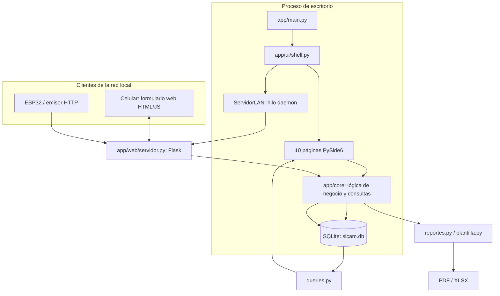

# SICAM — Referencia técnica, instalación, soporte y trazabilidad

> **Alcance revisado:** rama `main`, commit [`c6ba4a275a90bc7791a3cd10daef4c2fd4392c3f`](https://github.com/4beru/sicam-tf-in45/commit/c6ba4a275a90bc7791a3cd10daef4c2fd4392c3f).  
> Se inspeccionaron los módulos señalados en el encargo y los tests de la suite disponibles en el repositorio. No se modificó el código ni la base de datos del proyecto.

## 1. Arquitectura técnica

SICAM es una aplicación de escritorio PySide6 con una base SQLite local. La UI y la capa de negocio conviven en el proceso de escritorio; un servidor Flask/Werkzeug embebido en un hilo daemon sirve páginas de checklist y expone endpoints HTTP para IoT. La persistencia principal se encuentra en el archivo `sicam.db`.



### 1.1 Responsabilidades por capa

| Capa | Archivos | Responsabilidad |
|---|---|---|
| Punto de entrada | `app/main.py`, `main.py` | Inicializa Qt, estilos, DB/seed, `Shell`; el lanzador raíz existe para PyInstaller. |
| Shell y navegación | `app/ui/shell.py` | Barra lateral, selector mensual, selector de usuario visual, campana, tema, toast, statusbar, servidor y refresco periódico. |
| Páginas UI | `app/ui/*_page.py`, `app/ui/dashboard.py`, `app/ui/produccion.py`, `app/ui/no_conformidades.py` | Renderizan datos y enlazan controles con funciones del core. |
| Widgets/gráficos | `app/ui/widgets.py`, `app/ui/charts.py`, `app/ui/theme.py`, `app/ui/icons.py` | `Card`, `ResponsiveGrid`, tabla de solo lectura, chips, notificación temporal, gauges y gráficos `QPainter`. |
| Persistencia/esquema | `app/core/db.py` | Catálogos, DDL, ruta, conexión, WAL, claves foráneas, migración y helpers de vaciado/conteo. |
| Consultas analíticas | `app/core/queries.py` | Límites de mes, resumen, tendencias, Pareto, rankings, filtros y firma para refresco. |
| Negocio | `checklists.py`, `plan_tpm.py`, `iot.py`, `seed.py`, `integridad.py` | Reglas de checklist, calendario, señales, datos sintéticos, saneamiento. |
| Importación/reportes | `importador.py`, `plantilla.py`, `reportes.py` | Lectura/validación/upsert de Excel, plantillas, exportaciones XLSX y PDF. |
| Acceso móvil | `app/web/servidor.py` | Flask para página de estaciones, guardar checklist, salud y endpoints IoT. |
| Tests y packaging | `tests/`, `.github/workflows/build-exe.yml` | Tests unitarios/integración/UI offscreen y flujo Windows PyInstaller/Release. |

### 1.2 Recorrido normal de un dato

1. Un usuario registra un valor en un control PySide6, un operario envía el formulario móvil o llega un JSON HTTP.
2. El método de UI/endpoint valida los campos básicos y llama a una función en `app/core`.
3. La función core consulta o muta SQLite con `sqlite3`; una conexión abierta por el servidor se cierra al final de la petición.
4. La UI llama a `refresh_all()` tras algunas operaciones de escritorio. Cambios que llegan fuera de la UI se detectan con la firma cada 5 segundos (excepto lecturas, que usan el timer IoT de 2 segundos).
5. `queries.py` agrega valores para las vistas. Reportes invocan consultas y escriben documentos mediante ReportLab u openpyxl.

No hay broker MQTT, API gateway, base de datos central servidor, autenticación, autorización por rol, cola de trabajos ni sincronización offline implementada en el código inspeccionado.

## 2. Instalación y ejecución

### 2.1 Requisitos declarados

En `pyproject.toml` el proyecto requiere Python `>=3.12,<3.13`. Dependencias directas: Flask, openpyxl, Pillow, PySide6, qrcode y ReportLab. El grupo `dev` incluye PyInstaller y pytest. El proyecto usa `uv` como gestor en README y workflow de CI.

### 2.2 Preparar un entorno de desarrollo

Desde la raíz del repositorio, en una shell con Python 3.12 disponible:

```bash
uv sync
uv run python -m app.main
# Alternativa equivalente documentada para el lanzador raíz:
uv run python main.py
```

El arranque abre la interfaz Qt y trata de iniciar de forma automática el servidor LAN. Ejecutar en un entorno GUI apropiado si se requiere una ventana; en CI los tests usan la plataforma Qt offscreen.

Para pruebas:

```bash
QT_QPA_PLATFORM=offscreen uv run pytest -q
```

El workflow instala bibliotecas de sistema para Qt/EGL/xcb en Ubuntu antes de `uv sync`. Si PySide6 no importa en Linux sin display, se debe verificar primero la instalación de esas bibliotecas del sistema; `uv sync` por sí solo no las instala.

### 2.3 Rutas de datos

`app/core/db.py::ruta_data()` y `ruta_db()` definen la localización:

| Plataforma/configuración | Directorio / base |
|---|---|
| Variable `SICAM_DB` definida | Esa ruta se utiliza directamente como archivo SQLite; prevalece sobre las demás rutas. |
| Variable `SICAM_DATA` definida y `SICAM_DB` ausente | `SICAM_DATA/sicam.db`; fotos por defecto en `SICAM_DATA/fotos`. |
| Windows sin variables | `%APPDATA%/sicam/sicam.db`; la ruta de fotos por defecto se deriva de `ruta_data()/fotos`. |
| Linux/macOS sin variables | `~/.local/share/sicam/sicam.db`; fotos en `~/.local/share/sicam/fotos`. |

La conexión crea el directorio padre cuando es posible, activa SQLite WAL y `foreign_keys=ON` y aplica el esquema. Aun así, hay que asegurar permisos de escritura, espacio de disco y política de backup. El directorio de evidencia es externo al archivo SQLite: copiar solo la DB no preserva las fotografías.

### 2.4 Servidor LAN

- Puerto por defecto: `8080` (`app/web/servidor.py::PUERTO`).
- Se enlaza a `0.0.0.0`, de forma que puede aceptar conexiones por interfaces de red del PC.
- La URL se calcula con `ip_local()`, normalmente `http://<IP-LAN-del-PC>:8080`.
- El teléfono debe estar en la misma red en la que el PC sea alcanzable; un firewall puede bloquear conexiones entrantes.
- La UI advierte que en Windows podría ser necesario permitir el puerto 8080.
- Si el puerto está ocupado, `ServidorLAN.iniciar()` verifica el bind y lanza `OSError`, que la UI traduce en aviso/statusbar.
- `GET /health` permite comprobar servicio vía HTTP y devuelve `ok`.

**Seguridad:** el servidor no tiene autenticación ni autorización ni TLS en el código; el formulario permite elegir un operario de un listado, pero eso no autentica la identidad. No se debe exponer a Internet ni a una red no confiable sin diseñar primero controles de seguridad.

### 2.5 Endpoints web/IoT disponibles

| Método y ruta | Propósito | Solicitud / respuesta y validaciones |
|---|---|---|
| `GET /` | Listado de estaciones | Renderiza enlaces con código, tipo y área de máquinas registradas. |
| `GET /health` | Healthcheck simple | Texto plano `ok`. |
| `GET /<maquina>` | Formulario móvil | 404 si el código no existe; si existe, muestra plantilla de checklist según tipo. |
| `POST /<maquina>/guardar` | Guardar checklist | `multipart/form-data`; turno, operario, `item_i`, `estado_i`, `sev_i`, `com_i`, `foto_i` según elementos. Toda falla exige foto; límite de solicitud 16 MB; crea tarjetas por falla. |
| `POST /iot/lectura` | Ingresar lectura o evento D | JSON object. Requiere `maquina` existente. Para lectura continua: `variable` en `tension`, `velocidad`, `temperatura`, `vibracion` y `valor` numérico (no booleano). Para evento D, `nivel: "D"`, `valor` numérico; `variable` es opcional. Devuelve JSON con ID/nivel/alerta o error HTTP 400. |
| `GET /iot/estado` | Estado de lecturas | JSON con las últimas lecturas organizadas por máquina y variable. |

Ejemplo continuo:

```bash
curl -X POST http://IP-DEL-PC:8080/iot/lectura \
  -H 'Content-Type: application/json' \
  -d '{"maquina":"Costura 001","variable":"vibracion","valor":5.9}'
```

Ejemplo evento discreto:

```bash
curl -X POST http://IP-DEL-PC:8080/iot/lectura \
  -H 'Content-Type: application/json' \
  -d '{"maquina":"Costura 001","variable":"etiqueta","nivel":"D","valor":1}'
```

Para niveles distintos de D, `variable` debe ser uno de los cuatro valores admitidos. El endpoint registra origen `esp32` para las lecturas continuas; las alertas D no guardan origen en una columna propia.

## 3. Instalación/empaquetado de Windows y CI

`.github/workflows/build-exe.yml` contiene tres jobs:

1. `test`: Ubuntu, instala dependencias del sistema necesarias para Qt, hace `uv sync` y ejecuta `QT_QPA_PLATFORM=offscreen uv run pytest -q`.
2. `build`: Windows, depende de `test` y compila `SICAM.exe` con PyInstaller (`--onefile --windowed --name SICAM --paths . main.py`). En pushes a `main` sin tag, este job se omite; corre en dispatch manual o tag `v*`.
3. `release`: se ejecuta solamente al publicar un tag que comienza con `v`, descarga artefacto y adjunta `SICAM.exe` en GitHub Release.

La instalación de Windows como ejecutable no se debe confundir con un test visual de la app. El workflow compila el lanzador, pero el último run de push a `main` inspeccionado tuvo build omitido por condición del workflow.

## 4. Catálogos y datos sintéticos

Los catálogos centrales se encuentran en `app/core/db.py`: procesos `Costura`, `Corte`, `Etiquetado`, `Acabado`, `Calidad`; turnos `Mañana`, `Tarde`, `Noche`; seis causas; criticidades `Alta`, `Media`, `Baja`; áreas de máquinas. La plantilla Excel utiliza estas listas, y el importador exige coincidencia exacta en varias columnas.

`app/core/seed.py` produce un dataset reproducible con `random.Random(42)`: línea base 2024 y piloto julio–noviembre 2026; 30 estaciones que usan códigos `Costura 001` a `Costura 030`; operadores, frecuencias/metas, checklists de demostración, tarjetas, ejecuciones y lecturas IoT. Estos registros no acreditan un resultado real de producción.

La UI de mes ofrece agosto, setiembre, octubre y noviembre de 2026. La semilla también genera julio, y `queries.INICIO_PILOTO` usa `2026-07-01`. Una auditoría del piloto revisa expresamente agosto–noviembre, no julio como mes requerido. Por tanto, “semilla completa” y “meses seleccionables” tienen alcances distintos.

## 5. Errores frecuentes: diagnóstico y recuperación

| Síntoma | Causa comprobable / comprobar primero | Acción segura | Qué verificar |
|---|---|---|---|
| La app no abre DB | `SICAM_DB` apunta a ruta inválida, permisos, directorio no escribible o error SQLite. | Verificar variables de entorno, carpeta y permisos. No borrar DB. Hacer copia antes de intentar cualquier reparación. | Ruta mostrada, apertura de SQLite y log/diálogo original. |
| El celular no abre QR | Servidor inactivo, URL con placeholder IP, redes distintas, firewall/puerto ocupado o IP incorrecta. | Confirmar estado “Activo”, consultar URL base, usar el IP LAN alcanzable y revisar firewall de forma administrada. Probar `GET /health`. | Respuesta `ok`, después abrir la URL de estación. |
| QR guardado no funciona | Se generó sin servidor activo; el código contiene `IP-DEL-PC` o `<IP-de-este-PC>` como placeholder. | Activar servidor, regenerar/guardar el QR y comprobar la URL antes de imprimir. | El QR debe contener la URL real y código de máquina existente. |
| `404` al abrir estación | Código no existe en `maquinas`. | Revisar nombres exactos; los seed usan `Costura 001`–`030`, no `RECT-05`. | URL con código vigente y fila presente en catálogo. |
| Checklist con falla rechaza el envío | Falta foto adjunta o petición supera límite de 16 MB; otra validación falló. | Agregar fotografía a cada ítem FALLA; si es tamaño excesivo, redimensionar imagen y volver a enviar. | Confirmación de guardado, checklist y tarjeta que se deriva de la falla. |
| Lectura IoT devuelve 400 | JSON ausente/mal formado, máquina desconocida, variable no permitida o valor no numérico. | Enviar `Content-Type: application/json`, código de máquina real y variables válidas. Para D, incluir `nivel:"D"` y un valor numérico. | JSON de respuesta y fila persistida en la tabla correcta. |
| No aparece una nueva alerta A/C por cada lectura | Por diseño la alerta se inserta en primera lectura A/C o transición de nivel; niveles A/C repetidos no duplican cada segundo. | Revisar historial, nivel previo y alerta existente. No forzar la conclusión de error solo por no crear otra alerta. | Nivel actual, transición desde previo y contador de alertas pendientes. |
| Guardar producción rechaza la fecha | Fecha fuera del mes del navbar. | Cambiar mes global o ajustar fecha al periodo activo. | La fecha cumple el mes seleccionado; la tabla registra/actualiza esa clave. |
| Producción registra datos distintos a los esperados | Clave fecha+proceso+turno ya existía; la operación hace upsert y reemplaza cantidades. | Consultar fila existente antes de guardar; ingresar totales corregidos, no diferencias parciales. | La fila única contiene los nuevos totales. |
| Importación no se realiza | Una o más hojas/fila incumplen los catálogos o formatos. | Leer diálogo con hoja/fila, corregir el XLSX y validar de nuevo. La validación no toca las tablas de negocio. | Nuevo intento sin errores e historial con estado importado. |
| Reimportar XLSX incrementa las NC | La hoja `no_conformidades` usa inserción simple, no upsert. | No reimportar la misma hoja de NC a ciegas. Mantener copia/versionado y limpiar/conciliar duplicados mediante proceso revisado. | Conteo y lista de IDs/fechas/causas/cantidades antes y después. |
| No se ve un valor de calibración como vencido | Fecha vacía o no ISO; algunas fechas aceptadas por importación se guardan como texto original. | Corregir fecha a `AAAA-MM-DD` en una copia de datos y reimportar cuidadosamente o actualizar de forma controlada. | Que el texto se parsea con `date.fromisoformat`; auditoría semántica correspondiente. |
| No se registra ejecución al pulsar celda Plan TPM | Defecto de llamada: el diálogo invoca core sin pasar conexión SQLite requerida. | No dar por completada la tarea. Usar procedimiento operativo de contingencia previamente aprobado y registrar el defecto para corregir/pruebas. No editar la base productiva manualmente sin control. | Una fila en `plan_ejecuciones`, estado/fecha nueva y pruebas UI después de corregir. |
| Informe falla o archivo no aparece | Ruta cancelada/inaccesible, permisos o error de escritura. | Seleccionar ruta escribible, espacio libre y extensión apropiada; conservar el error original. | Existe el archivo, tamaño no nulo y PDF comienza `%PDF-` o XLSX abre correctamente. |
| Auditoría informa problemas pese a `integrity_check=ok` | Estructura SQLite correcta pero inconsistencia semántica: cantidades, referencias, catálogo o semilla. | Leer cada hallazgo, corregir datos dudosos con criterio de negocio. Auditoría no infiere cambios para todo problema. | Volver a auditar y revisar tanto reparaciones como problemas restantes. |
| Reset abortado | Seed regenerada no supera auditoría u ocurre excepción. | El código intenta restaurar la copia de SQLite guardada en memoria. Conservar el mensaje y revisar que volvió el conteo previo. | Conteos anteriores, tablas y referencias. Fotos aún no se borran en la ruta de fallo normal del bloque. |
| Tras reset faltan fotos antiguas | El reset elimina evidencias referenciadas solo después de que la nueva DB supera auditoría. La copia en memoria no contiene imágenes. | No existe recuperación de fotos incorporada; restaurar desde backup externo de la carpeta de evidencias si se necesita. | Base semilla, conteos esperados y carpeta de evidencias. |

## 6. Seguridad, riesgos y límites operativos

1. **Autenticación:** no existe login real ni autorización por roles. El selector de usuario es visual; cualquier persona con acceso a la aplicación ve las páginas y controles.
2. **Servidor sin protección:** Flask atiende en `0.0.0.0`, sin HTTPS, credenciales, autorización por estación ni token para el endpoint IoT. Operarlo solo en una red local confiable y revisar firewall.
3. **Fotos fuera de la BD:** se necesita backup tanto del archivo SQLite como de la carpeta `fotos`; el backup en memoria usado para reset solo cubre SQLite.
4. **Datos de demostración y reales mezclables:** `origen_dato` distingue la procedencia en producción/NC, pero no todas las tablas tienen dicha marca; el Dashboard puede combinar datos por agregación.
5. **Plan TPM:** la lógica core está separada y tiene tests, pero la acción desde `EjecucionDialog` no está correctamente enlazada en el código actual.
6. **Importación NC:** sin clave natural ni upsert, repetir importación añade filas. Además, la exportación/plantilla no incluye observación.
7. **Integridad parcial:** solo se valida el conjunto de reglas programadas en `integridad.py`; no debe considerarse un motor exhaustivo de integridad de proceso.
8. **Métrica engañosa o incompleta:** etiqueta “Tarjetas 12 m” no filtra doce meses; título “Última hora” no filtra 60 minutos; toast menciona MTTR sin cálculo encontrado.
9. **Operación de reset:** no es idempotente desde la perspectiva del usuario real: elimina la información operativa para regresar al demo. La eliminación de fotos es irreversible dentro de las capacidades actuales.
10. **Validación industrial:** los colores, umbrales y severidades son configuraciones de un MVP y requieren autorización de la persona competente antes de usarse como instrucciones de detener equipos reales.

## 7. Discrepancias entre interfaz, comentarios y comportamiento

| Hallazgo | Evidencia de código | Impacto |
|---|---|---|
| Selector de usuario parece selector de rol, pero no restringe | `app/ui/shell.py`, callback muestra aviso de que el filtro por rol es de fase futura. | No describirlo como autenticación o permisos. |
| Menú mensual no incluye todos los meses sintéticos | `Shell.MESES_PILOTO` contiene Ago–Nov; `seed.PILOTO` tiene Jul–Nov y `queries.INICIO_PILOTO` parte de julio. | El usuario no puede elegir julio en navbar, aunque existe en el dataset. |
| Máquinas de ejemplo pueden diferir de códigos de documento antiguo | Seed canónica crea `Costura 001`–`030`; web/API valida que máquina exista. | Identificadores como `RECT-05` solo funcionan si están realmente cargados, no por aparecer en comentario de ejemplo. |
| Importación no duplica no es universal | `importador.importar()` hace upsert en 5 entidades pero inserción simple para NC. | Repetir una hoja NC crea registros duplicados. |
| UI de registro de plan TPM omite conexión | `app/ui/plan_page.py::EjecucionDialog._guardar` frente a firma `plan_tpm.registrar_ejecucion(conn, maquina, actividad, ...)`. | Accionar botón no ejecuta la función como está previsto. |
| `Tarjetas 12 m` sin filtro de fechas | `app/ui/maquinas_page.py::_pintar_detalle` usa `SELECT COUNT(*) ... WHERE maquina=?`. | Valor es conteo histórico y etiqueta es incorrecta. |
| Pareto y ranking NC usan prendas, no filas | `queries.py::pareto`, `resumen_mes` y rankings suman `cantidad`. | Interpretar el volumen como número de prendas afectadas. |
| KPI de tasa y NC por causa proceden de tablas diferentes | tasa desde `produccion`; Pareto/rankings desde `no_conformidades`. | Los valores pueden divergir sin que cada fila esté ligada a una inspección. |
| `última hora` muestra 60 muestras | `iot.historial(..., limite=60)` selecciona por ID; no aplica condición `ts >= now-60min`. | El periodo temporal de la etiqueta no refleja la consulta real. |
| Guardar umbrales indica “recalculan” alertas | `iot.actualizar_umbral` actualiza configuración; no reescribe lecturas/alertas anteriores. | Solo lecturas futuras usan nueva configuración; toast puede confundir. |
| “MTTR recalculado” sin métrica | Mensaje UI tras cambio de tarjeta; esquema no contiene comienzo/duración ni función de MTTR. | No usar el mensaje como evidencia de indicador calculado. |
| Comentario de “5 de 7 estaciones” obsoleto | `seed.py::sembrar_fase2` comentario frente a `asegurar_maquinas_costura` y test con total 30. | La tasa demostrativa hoy se calcula con 30 máquinas; seed podría mostrar 5/30. |
| Plantilla no contiene `observacion` en NC | `plantilla.HOJAS['no_conformidades']` solo contiene 8 columnas; export también usa esas columnas. | La observación no sobrevive a un ciclo de exportar→editar→reimportar. |
| Endpoint de checklist tiene fallback de operarios potencialmente defectuoso | `_html_formulario` cierra `conn` antes de consultar todos los operarios en fallback si no hay resultados por área. | Máquina con área sin operarios puede disparar error en el render. |
| Foto requerida solo por flujo web | `servidor.guardar` rechaza falla sin archivo; `checklists.registrar_checklist` no requiere foto en core. | Llamadas directas de negocio/tests pueden crear falla sin foto. |

## 8. Matriz de trazabilidad funcional y de pruebas

**Estado de verificación** se refiere a lectura de implementación y alcance de pruebas en el último CI, no a inspección manual de todas las pantallas en un dispositivo físico.

| Funcionalidad | Pantalla / entrada | Lógica principal | Tablas | Test relacionado | Estado al revisar `main` |
|---|---|---|---|---|---|
| Conectar/crear esquema y rutas | Arranque | `db.conectar`, `ruta_db`, `ruta_data` | Todas | Tests que usan DB temporal; CI | Esquema inspeccionado; no prueba instalación en todo PC. |
| Seed e idempotencia | Inicio / reset | `seed.siembra`, fases 2–4 | Producción, NC, catálogos, checklist, TPM, IoT | `tests/test_seed.py`, `tests/test_datos_reset.py` | Core probado; seed es sintética. |
| Registro de producción | Producción diaria | `ProduccionPage._agregar`, `queries.*` | `produccion` | `tests/test_seed.py`, `tests/test_integridad.py` | Validaciones inspeccionadas; no test específico de clic/formulario. |
| Registro de NC manual | No conformidades | `RegistroNCDialog._guardar` | `no_conformidades` | Indirecto en `test_iot.py`; tests seed | Código inspeccionado; formulario manual no tiene test UI específico encontrado. |
| Pareto/tendencia/rankings | Dashboard / Reportes | `queries.pareto`, `tasa_mensual`, rankings | NC, producción, metas | `tests/test_seed.py`, `tests/test_plan_tpm.py` | Fórmulas revisadas y parte del core probada. |
| Checklist → tarjeta TPM | Celular / Checklists | `checklists.registrar_checklist` | `checklists`, `checklist_items`, `tarjetas_tpm` | `tests/test_checklists.py`, `tests/test_web.py` | Cubierto en core y cliente Flask de prueba. |
| Evidencia de checklist | Celular/Detalle | guardado de archivo y path | `checklist_items.foto` y filesystem | `tests/test_checklists.py`, `test_web.py`, `test_datos_reset.py` | Cubierto en pruebas con archivos temporales. |
| Ciclo TPM | Tarjetas | `cambiar_estado_tarjeta`, diálogos | `tarjetas_tpm` | `tests/test_checklists.py` | Core probado; UI asigna responsable fijo y no mide MTTR. |
| Ficha de máquina/calibración | Máquinas | `_estado_calibracion`, `proxima_tarea` | `maquinas`, tarjetas, frecuencias/ejecuciones | No se identificó test dedicado de UI/calibración | Inspección estática. |
| Motor Plan TPM | Plan TPM | `tareas_del_mes`, `resumen`, `registrar_ejecucion` | `frecuencias`, `plan_ejecuciones` | `tests/test_plan_tpm.py` | Core probado; camino de botón UI tiene defecto conocido. |
| Lecturas y reglas de alerta | Monitor IoT | `registrar_lectura`, `clasificar`, `simular_paso` | `iot_umbrales`, `iot_lecturas`, `iot_alertas` | `tests/test_iot.py` | Cobertura de core. |
| Acciones UI IoT | Monitor IoT | handlers `IotPage` | IoT, TPM, NC | `tests/test_iot_ui.py` | Pruebas de UI offscreen declaradas. |
| Endpoint lectura/estado | HTTP | `crear_app`, rutas `/iot/*` | IoT, máquinas | `tests/test_web.py` | Flask test client cubre validaciones principales. |
| Generar plantilla/validación/upsert | Datos e importación | `plantilla`, `importador` | máquinas, operarios, producción, NC, frecuencias, metas, importaciones | `tests/test_importador.py` | Incluye prueba explícita de NC duplicadas en reimportación. |
| Reportes PDF | Reportes / Plan | `reportes.pdf_*` | producción/NC/metas/plan | `tests/test_plan_tpm.py::test_pdfs_se_generan` | PDF válido por firma/tamaño; no revisión visual exhaustiva. |
| Auditoría | Datos e importación | `integridad.auditar_y_reparar` | Varias | `tests/test_integridad.py` | Reglas seleccionadas verificadas. |
| Restablecimiento de piloto | Datos e importación | `DatosPage._resembrar`, copia `:memory:` | Todas las tablas piloto + fotos | `tests/test_datos_reset.py` | Test regresión en base temporal. No aplicar sobre datos reales. |
| Cambio de mes/refresco | Shell | `_cambiar_mes`, `firma_datos`, timers | Varias | test de mes en `tests/test_iot_ui.py`; `test_plan_tpm.py` para firma | Parte probado; no cubre toda combinación de vistas. |
| Build Windows | Workflow | PyInstaller en Windows | — | Job CI `build` | Último push a main omitió build por condición del workflow. |

## 9. Estado actual de CI revisado

Se consultó la API pública de GitHub Actions del repositorio.

- **Último run visible inspeccionado:** [run #25 — Fix photo directory setup in pilot reset test](https://github.com/4beru/sicam-tf-in45/actions/runs/38117609581), commit `c6ba4a2`, terminado con `success` el 11-10-2026.
- El log de job `test` registra **65 passed in 17.24s**.
- En ese run, `build` y `release` aparecen como `skipped`, consistente con el condicional del workflow: push a `main` ejecuta tests, pero el EXE se compila para despacho manual o tag `v*`; release solo para tag.
- Runs inmediatamente anteriores #23 y #24 terminaron en fallo durante iteraciones de la prueba de restablecimiento; #25 corrige la preparación del directorio de fotos y queda verde.

Esto demuestra que los tests de CI pasaron para el commit consultado, pero **no** demuestra que todos los botones, gráficos y layouts se hayan inspeccionado manualmente, ni que la versión Windows se haya compilado en el último push.

## 10. Índice técnico rápido: “¿Dónde se hace…?”

| Pregunta | Archivo y función / clase |
|---|---|
| ¿Dónde se calcula tasa NC y KPI mensual? | `app/core/queries.py::resumen_mes`, `tasa_mensual`, `tasa_diaria`; `app/ui/dashboard.py::DashboardPage.refresh`; `app/ui/produccion.py::_actualizar_previsualizacion_tasa`. |
| ¿Dónde se calculan límites/mes activo? | `app/core/queries.py::limites_mes`, `fecha_referencia_mes`; `app/ui/shell.py::Shell._cambiar_mes`. |
| ¿Dónde se define esquema y ruta SQLite? | `app/core/db.py::ESQUEMA`, `ruta_data`, `ruta_db`, `conectar`, `vaciar`. |
| ¿Dónde se genera seed de demo? | `app/core/seed.py::siembra`, `sembrar_fase2`, `sembrar_fase3`, `sembrar_fase4`. |
| ¿Dónde se valida y guarda un checklist? | `app/web/servidor.py::crear_app`, ruta `guardar`; `app/core/checklists.py::registrar_checklist`. |
| ¿Dónde están las plantillas por tipo de máquina? | `app/core/checklists.py::PLANTILLAS`, `items_de_maquina`. |
| ¿Dónde una falla crea tarjeta TPM? | `app/core/checklists.py::registrar_checklist`. |
| ¿Dónde cambia estado de tarjeta? | `app/core/checklists.py::cambiar_estado_tarjeta`; UI `app/ui/tarjetas_page.py::DetalleTarjetaDialog`. |
| ¿Dónde se crean tarjetas manuales? | `app/core/checklists.py::crear_tarjeta_manual`; `app/ui/tarjetas_page.py::NuevaTarjetaDialog`. |
| ¿Dónde se calcula el calendario TPM? | `app/core/plan_tpm.py::tareas_del_mes`, `ultima_ejecucion`, `_base_inicial`, `semana_de`, `resumen`, `proxima_tarea`. |
| ¿Dónde se registra una ejecución? | `app/core/plan_tpm.py::registrar_ejecucion`; UI enlaza en `app/ui/plan_page.py::EjecucionDialog._guardar` (actualmente defectuoso por argumento `conn` omitido). |
| ¿Dónde se clasifica una lectura? | `app/core/iot.py::clasificar`, `registrar_lectura`, `simular_paso`. |
| ¿Dónde se convierte alerta A/C en TPM? | `app/core/iot.py::crear_tarjeta_desde_alerta`. |
| ¿Dónde se convierte alerta D en NC? | `app/core/iot.py::registrar_nc_desde_alerta`. |
| ¿Dónde se sirve el API HTTP? | `app/web/servidor.py::crear_app`; `ServidorLAN.iniciar`, `ip_local`, `url_base`. |
| ¿Dónde se genera la plantilla Excel? | `app/core/plantilla.py::HOJAS`, `generar_plantilla`. |
| ¿Dónde se valida archivo Excel? | `app/core/importador.py::leer`, `validar`. |
| ¿Dónde se hace upsert de entidades? | `app/core/importador.py::importar`; los bloques para NC usan insert simple. |
| ¿Dónde se exportan NC? | `app/core/plantilla.py::exportar_no_conformidades`. |
| ¿Dónde se generan PDFs? | `app/core/reportes.py::pdf_plan`, `pdf_pareto`, `pdf_indicadores`. |
| ¿Dónde se audita/repara integridad? | `app/core/integridad.py::auditar_y_reparar`. |
| ¿Dónde está el restablecimiento? | `app/ui/datos_page.py::DatosPage._resembrar`; `app/core/seed.py::siembra(reset=True)`, `app/core/db.py::vaciar`. |
| ¿Dónde se refrescan pantallas cuando cambia SQLite? | `app/core/queries.py::firma_datos`; `app/ui/shell.py::Shell._revisar_cambios`, `refresh_all`, `ir_a`. |
| ¿Dónde se crean tablas/estilos/grids compartidos? | `app/ui/widgets.py::Card`, `ResponsiveGrid`, `tabla`, `Toast`, `vaciar_layout`. |
| ¿Dónde está empaquetado de Windows? | `main.py` + `.github/workflows/build-exe.yml`. |

## 11. Pruebas que faltan o no pueden inferirse de CI

La suite observada cubre core e integración, varios endpoints Flask, interacciones IoT y reset con Qt offscreen. Aun así, no se identificó cobertura explícita para:

- Guardado por el botón real de “Registrar ejecución” de Plan TPM, donde aparece el defecto de argumento.
- Revisión visual/manual completa de las diez pantallas en Windows y Linux.
- Todos los casos límite de formularios NC/producción y todos los filtros del Dashboard.
- Seguridad de red, autorización, ataques de archivos/cargas, autenticación de dispositivos ni TLS.
- Interoperabilidad con hardware ESP32 real, calidad/calibración de sensores ni tiempos de red industriales.
- Recuperación de fotografías después de borrado durante el reset.
- Importación masiva de archivos maliciosos, XLSX de gran volumen, archivos parciales con hojas faltantes y comportamiento de negocio de cada columna no principal.
- Consistencia real entre volúmenes agregados de producción, filas de NC de origen manual/importación y reportes históricos.
- Exactitud del texto “última hora”, “12 m” y “MTTR recalculado” mediante métricas automatizadas.

Una prueba verde cubre solo las condiciones que se ejecutaron. Al añadir tests, conviene usar DB y carpeta de fotos temporales para mantener el aislamiento y no usar la base de usuario.

## 12. Recomendaciones de evolución (no funcionalidades actuales)

Las propuestas de esta sección son recomendaciones, no características implementadas:

1. Corregir el argumento de conexión en el diálogo de ejecución TPM y añadir test UI end-to-end que pulse una tarea y verifique la inserción.
2. Definir clave natural/deduplicación para `no_conformidades` en importación; añadir `observacion` a plantilla, exportación y validación si debe conservarse.
3. Corregir filtros temporales de “Tarjetas 12 m” y “Última hora”; cambiar el texto si la intención es mostrar últimas 60 muestras, o filtrar por timestamp si la intención es la última hora.
4. Sustituir el responsable hardcodeado por selección obligatoria y añadir notas/fecha de intervención, evidencia posterior y criterio de cierre si se necesita una trazabilidad TPM real.
5. Distinguir origen de alertas D en base de datos, asociar autor/timestamp de atención y tener política para alertas sin acción.
6. Implementar autenticación/autorización, protección de endpoints y segmentación de red antes de integrar hardware en una red operativa.
7. Añadir una política de backup/restauración que cubra DB **y** evidencias; habilitar confirmación más robusta para resets destructivos y auditoría previa.
8. Versionar el esquema y las migraciones de DB de forma explícita; ampliar auditoría semántica e informes de cobertura.
9. Separar en métricas la cantidad de filas de NC, la cantidad de prendas no conformes registradas y las NC detectadas en producción, definiendo reconciliación y fórmulas institucionales.
10. Añadir pruebas UI para cada operación que muta datos y una revisión visual en Windows, además de los tests offscreen.